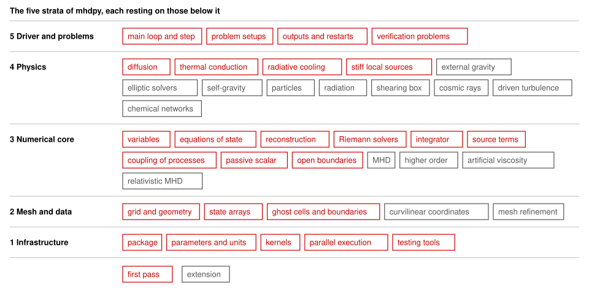

# Overview of mhdpy

*A paragraph on what mhdpy is, for a newcomer, and on what this overview holds and for whom: the goals, the context of a run, the layers and how a step runs through them, what the layers share, and the briefs that build them. About 80 words with the line below.*

**Where the work stands.** *The stratum in progress and its next brief, as part 6 lists them.*

## 1. Goals

*The goals, scope and success criteria of mhdpy, moved from §1.1 to §1.3 of CLAUDE.md in step 7 of `design/overview/plan.md`, with a pointer to the priorities, which stay in §1.4 of CLAUDE.md. About 500 words.*

### 1.1 Goals

### 1.2 Scope

### 1.3 Success criteria

## 2. Context of a run

*What a user brings to mhdpy, a problem setup with its parameters, what a run does with it, and what comes out for analysis, on the development machine and a small server. About 150 words.*

## 3. Layers

mhdpy is cut into five strata by the kind of code that each holds, after the layers pattern of [Buschmann et al.](#buschmann-et-al-1996) (1996). Each stratum rests on those below it and is finished before the next is begun, with its briefs, then its requirements, then its code, as §2.3 of [CLAUDE.md](../CLAUDE.md) asks. A first pass builds the five strata for the production run of [§1.3](#13-success-criteria), hydrodynamics with radiative cooling, thermal conduction and a passive scalar, and provides for the rest of the scope where this costs little. Every other module of the scope of [§1.2](#12-scope) enters later, as an extension of the stratum of its kind of code, MHD first. No problem runs before the driver of stratum 5 exists, so that the lower strata are checked by tests of their own, the numerical core also by a small loop in its tests that steps problems with known solutions.

*Each subsection grows in step 6 of the plan into what its stratum holds, what it must provide to the strata above, and the tests that close it, in about 220 words.*

### 3.1 Infrastructure

The code that every stratum runs on and that knows nothing of grids or physics: the package and its installation ([topic 35](topics/35-packaging-configuration-and-build.md)), runtime parameters and units ([topic 37, §2.5](topics/37-driver-and-control-of-time-step.md#25-runtime-parameters-and-units)), the route of the [kernels](#kernel) ([topic 41](topics/41-vectorised-and-compiled-kernels.md)), execution in parallel and the measure of [cell updates](#cell-update) ([topic 42](topics/42-parallelisation-and-performance.md)), and the tools of testing ([topic 28](topics/28-verification-and-testing.md)).

To the strata above, it provides the route in which they write their loops over cells, [vectorised](#vectorisation) in NumPy or compiled, fast enough for the rate of cell updates that the production run needs, and an execution in parallel, by threads or by processes, which the layout of the data in stratum 2 and the driver of stratum 5 serve. Every module declares its parameters with their defaults, which the driver reads and records, and finds the physical units and constants that cooling and conduction need. The tests of every stratum use its norms, [orders of convergence](#order-of-convergence), checks of conservation and [regression tests](#regression-test), and its check lists the requirements that no test cites. For the extensions it leaves room for compiled kernels and for communication across the whole grid, which the inversion of relativistic MHD, the deposition of particles and the Fourier transforms of self-gravity and driven turbulence need.

It is closed by tests of its own, since tools of verification need tests as much as the code that they check ([topic 28, §4](topics/28-verification-and-testing.md#4-assessment)): parameters with defaults, overrides and unknown names, units against their constants, the tools of testing on sequences of known order, and the installation by one command on clean macOS and Linux, the latter in Docker.

### 3.2 Mesh and data

The code that holds the state on the grid: coordinates with a geometry kept general ([topic 3](topics/03-grids-and-finite-volume-discretisation.md)), the arrays of the state with room for the face fields of MHD ([topic 36](topics/36-data-structures.md)), and ghost cells with the standard boundaries and their exchange between blocks ([topic 4](topics/04-boundary-conditions-and-ghost-cells.md)). Extensions: curvilinear coordinates ([topic 12](topics/12-curvilinear-coordinates.md)) and mesh refinement ([topic 40](topics/40-mesh-refinement.md)).

### 3.3 Numerical core

The code that advances the equations of the gas: its variables ([topic 1](topics/01-equations-and-their-variables.md)), equations of state ([topic 2](topics/02-equations-of-state.md)), reconstruction ([topic 6](topics/06-reconstruction-and-limiting.md)), Riemann solvers ([topic 7](topics/07-riemann-solvers.md)), the integrator ([topic 8](topics/08-time-integration.md)), source terms ([topic 13](topics/13-source-terms.md)), the coupling of processes within a step ([topic 18](topics/18-operator-splitting-and-coupling-of-processes.md)), the passive scalar, whose flux is the mass flux of the gas ([topic 21](topics/21-passive-scalars.md)), and open boundaries ([topic 5](topics/05-non-reflecting-boundaries.md)). Extensions: MHD with constrained transport ([topic 11](topics/11-constrained-transport.md)) first, then methods of higher order ([topic 9](topics/09-methods-of-higher-order.md)), artificial viscosity ([topic 10](topics/10-artificial-viscosity.md)) and relativistic MHD ([topic 25](topics/25-relativistic-mhd.md)).

### 3.4 Physics

The modules that add processes to the flow: diffusion ([topic 16](topics/16-diffusion.md)) and thermal conduction ([topic 17](topics/17-thermal-conduction.md)), and radiative cooling ([topic 20](topics/20-radiative-cooling.md)) with the integration of local, stiff sources ([topic 19](topics/19-reactions-chemistry-and-cooling.md)). Extensions: elliptic solvers and self-gravity ([topic 14](topics/14-elliptic-solvers.md), [topic 15](topics/15-self-gravity.md)), particles ([topic 22](topics/22-particles.md)), radiation ([topic 23](topics/23-radiation-transport.md)), the shearing box ([topic 24](topics/24-shearing-box-and-orbital-advection.md)), cosmic rays ([topic 26](topics/26-cosmic-rays.md)), driven turbulence ([topic 27](topics/27-driving-of-turbulence.md)) and chemical networks.

### 3.5 Driver and problems

The code that turns the solver into a run: the main loop and the control of its step ([topic 37](topics/37-driver-and-control-of-time-step.md)), problem setups and user functions ([topic 38](topics/38-problem-setups-and-user-functions.md)), outputs, restarts and analysis ([topic 39](topics/39-output-restarts-and-analysis.md)), and the problems that verify the whole scheme ([topic 29](topics/29-advection-and-linear-waves.md) to [topic 34](topics/34-cold-clouds-and-mixing-layers.md)).

## 4. One time step

*One step of the production run, with hydrodynamics, radiative cooling, thermal conduction and a passive scalar, traced down through the strata in numbered steps, each naming its stratum, with each choice of method left to its brief and linked to its topic. About 250 words.*

## 5. Crosscutting concepts

Some conventions bind every stratum, although no stratum holds them, and each is settled by the briefs of the stratum named: how kernels are written, vectorised or compiled ([topic 41](topics/41-vectorised-and-compiled-kernels.md)), execution in parallel and the measure of performance ([topic 42](topics/42-parallelisation-and-performance.md)), runtime parameters and units ([topic 37, §2.5](topics/37-driver-and-control-of-time-step.md#25-runtime-parameters-and-units)), and testing and verification ([topic 28](topics/28-verification-and-testing.md)), in stratum 1; the naming and indexing of variables ([topic 36](topics/36-data-structures.md)), in stratum 2; precision, floors and unphysical states ([topic 2](topics/02-equations-of-state.md)), in stratum 3; the way modules plug in, by boundaries, sources and the hooks of problems ([topic 13](topics/13-source-terms.md), [topic 38](topics/38-problem-setups-and-user-functions.md)), in strata 2, 3 and 5; and reproducibility, by recorded versions, seeds and exact restarts ([topic 39](topics/39-output-restarts-and-analysis.md)), in stratum 5.

*Each concept gains a sentence or two and the brief that settles it in step 6 of the plan, in about 300 words in all.*

## 6. Briefs

Briefs are opened stratum by stratum, from infrastructure upwards, those of the first pass before the extensions. A brief is opened in the lowest stratum whose code its decision shapes, even where most of its code lies higher: the coupling of processes within a step is decided with the integrator of stratum 3, although the driver of stratum 5 runs it.

Each stratum has a table of its briefs in the order in which they are opened. A brief not yet opened has no identifier, since it receives one only when it is opened, and its subject names the questions that it settles. The status reads Not begun, Open, or Decided with its date, and the last column names what a decided brief changed in the overview, with a link to the sub-decision. A line on the requirements and code of the stratum follows its table.

### 6.1 Infrastructure

| Brief | Subject | Topics | Status | Changed in the overview |
|---|---|---|---|---|
| — | The strata in the package: their subpackages, the rule of use between them, and how the rule is checked | [35, §2.1](topics/35-packaging-configuration-and-build.md#21-python-packages) | Not begun | |
| — | The route of the kernels: vectorised or compiled, a simple version to check a fast one, and the benchmark by which the rate of cell updates is tracked | [41](topics/41-vectorised-and-compiled-kernels.md), [36, §2.5](topics/36-data-structures.md#25-layouts-for-kernels) | Not begun | |
| — | Execution in parallel: threads in the [free-threaded build](#free-threaded-build) or processes with [MPI](#mpi), and whether it enters the first pass | [42](topics/42-parallelisation-and-performance.md) | Not begun | |
| — | The package and its installation: the build backend, the versions of Python, the dependencies, the licence and the releases | [35](topics/35-packaging-configuration-and-build.md) | Not begun | |
| — | Runtime parameters and units: their format, declaration and record, and the system of units with its constants | [37, §2.5](topics/37-driver-and-control-of-time-step.md#25-runtime-parameters-and-units) | Not begun | |
| — | Testing and verification: the norms and variables of orders, conservation, the tolerance of regression tests, and the check of requirements | [28](topics/28-verification-and-testing.md) | Not begun | |

Requirements and code: not begun.

*The tables of strata 2 to 5 follow in steps 6b to 6e of the plan.*

## 7. Glossary

- **Cell update.** The advance of one cell by one time step. Their number sets the cost of a run, and their rate per second its speed ([topic 42, §2.1](topics/42-parallelisation-and-performance.md#21-the-cost-of-a-simulation)).
- **Free-threaded build.** A build of Python without the global interpreter lock, in which threads run Python code at the same time on several cores ([topic 42, §2.5](topics/42-parallelisation-and-performance.md#25-threads-and-processes-in-python)).
- **Kernel.** A loop over the cells of a grid that performs one operation of the scheme, such as a reconstruction or a Riemann solver. Kernels take most of the time of a run ([topic 41](topics/41-vectorised-and-compiled-kernels.md)).
- **MPI.** The Message Passing Interface, a standard by which separate processes, on one machine or on many, exchange data ([topic 42, §2.4](topics/42-parallelisation-and-performance.md#24-parallel-execution)).
- **Order of convergence.** The power of the cell width with which the error falls as the grid is refined, two for a scheme of second order on a smooth problem ([topic 28, §2.2](topics/28-verification-and-testing.md#22-norms-and-the-order-of-convergence)).
- **Regression test.** A test that compares the result of a run with one stored earlier, so that an unintended change shows ([topic 28, §2.5](topics/28-verification-and-testing.md#25-regression-tests-and-reproducibility)).
- **Vectorisation.** Writing a kernel as operations on whole arrays, which NumPy performs in compiled loops, rather than as a loop in Python over the cells ([topic 41, §2.1](topics/41-vectorised-and-compiled-kernels.md#21-vectorisation-in-numpy)).

*The entries of strata 2 to 5 and of the remaining parts follow in steps 6b to 6f of the plan, each term with an anchor, a sentence and its topic, in alphabetical order.*

## Sources

*The established practice that the overview follows and the references that it cites directly, as anchored entries in the format of the topic summaries.*

- Buschmann, F., Meunier, R., Rohnert, H., Sommerlad, P. and Stal, M., Pattern-oriented software architecture, volume 1: a system of patterns, Wiley (1996).
