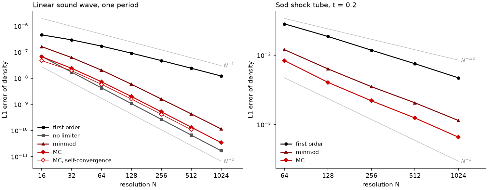

# D02 — Verification strategy

| | |
|---|---|
| Status | Decided (frozen) |
| Decided | 2026-10-10 |
| Supersedes | — |
| Superseded by | — |

## 1. Introduction

Correctness is the first priority of mhdpy (architecture.md §1.4), and its success criterion is concrete. No physics module is complete before it has been verified against problems with known solutions. On smooth problems, the measured order of convergence must match the formal order of the scheme; problems with discontinuities are compared with exact or reference solutions. Conserved quantities must be conserved to round-off wherever the boundary conditions permit. And a capability counts as implemented once the corresponding tests of the reference codes are reproduced. This brief decides how that criterion is put into practice: which kinds of tests exist, what results are compared against, what counts as passing, how often each kind runs, and how it is recorded which capability has been verified by which test.

The brief sits low in the stack because every later layer delivers its components together with their tests, in the form decided here. Brief D01 already fixed the frame. pytest is the runner (D01.9). Tests live next to the component they test and ship with the package, while large reference data does not (D01.4). CI runs on macOS and Linux for Python 3.13 and 3.14, plus a job with the lowest allowed dependency versions (D01.1, D01.2, D01.6).

A distinction from the verification literature helps to scope the brief. **[GK]** *Verification* asks whether the equations are solved correctly; *validation* asks whether they are the right equations for nature. mhdpy's success criterion is about verification. Validation, the comparison with experiments or observations, belongs to the scientific use of the code and is outside this brief.

**What the references do** (Athena, Pyro, Ulula and ZEUS syntheses in `References/`, the CompHydro book synthesis, and the code in each `Code/` folder):

| | Athena++ | Pyro | Ulula | ZEUS |
|---|---|---|---|---|
| Automated tests | 84 regression tests in suites (hydro, mhd, amr, curvilinear, …), each a Python module with `prepare`, `run` and `analyze` | 15 pytest unit-test files next to the solvers; a regression driver over solver/problem pairs | none | (no code available) |
| Compared against | analytic solutions, computed by the executable itself (errors written to a file) | 20 stored benchmark outputs (HDF5, 39 MB in total, the largest 14 MB) | exact solutions overlaid in plots | analytic solutions; self-convergence |
| Acceptance | absolute error below a threshold at a fixed resolution, *and* error ratio per doubling below a threshold: ≤ 0.33 for linear waves (order ≳ 1.6), ≤ 0.6 for the Sod shock tube | zone-by-zone agreement within relative tolerance 1e-12 (the 2014 paper argues for bit-for-bit comparison) | visual; convergence plots in the paper | — |
| Invariants checked | symmetry: left- and right-going waves must give *identical* errors; the same number of cycles in every direction; near-identical results across 1D/2D/3D (atol 5e-15) | — | conservation monitored during runs | — |
| Stored data | 5.2 MB for a handful of tests (chemistry, a relativistic shock, an MRI history) | everything | — | — |
| Coverage | about 65 % of C++ lines (S20) | measured (pytest-cov) | — | — |

Three further lessons come from the book and ZEUS:

- **Smooth problems for convergence, discontinuities for the rest.** Convergence tests need smooth initial data, because limiters drop the order at discontinuities and extrema. Shock tubes are therefore unsuitable for measuring order. They are, however, excellent *symmetry* tests: the mirrored problem must give the mirrored solution to round-off. A classic cause of broken symmetry is a branch such as `if u > 0: … else: …`, which silently treats `u = 0` as negative.
- **Self-convergence where no exact solution exists.** Multiphysics problems rarely have analytic solutions. Their convergence is measured by comparing runs at N and 2N, with the finer one coarsened to the coarser grid (book §13.5). ZEUS recommends three styles of convergence testing: single-step, extended evolution against an analytic solution, and self-convergence.
- **Build up from components to the whole code** (ZEUS): test each component on its own before the integrated problems.

The Athena synthesis adds a warning for test design. Apparent violations of Galilean invariance in moving-frame tests come from under-resolved interfaces, not from the solver, so a test's resolution must be chosen with its purpose in mind.

## 2. Evidence

Both experiments use a deliberately minimal one-dimensional solver, [`experiments/E02.1-hydro1d.py`](experiments/E02.1-hydro1d.py). It has piecewise-linear reconstruction of the primitive variables with a choice of limiter, the HLL Riemann solver, SSP-RK2 time integration (CFL 0.4, γ = 1.4) and an exact Riemann solver after Toro. It behaves like the schemes mhdpy will use, without being an early version of mhdpy.

### E02.1 — How convergence tests behave, and what they cost

**Question.** What do convergence measurements actually look like for a second-order scheme: with and without limiters, against exact solutions and by self-convergence, on smooth and discontinuous problems? What do they cost, and therefore what can CI afford?

**Method.** [`experiments/E02.1-convergence.py`](experiments/E02.1-convergence.py) (NumPy 2.5.3, Python 3.14.8, own lockfile; development machine) runs the following:

- a linear sound wave (amplitude 10⁻⁶, one period, exact solution = initial state) at N = 16 … 1024, with first-order reconstruction, and second-order reconstruction without limiter, with minmod and with MC;
- the same problem measured by self-convergence, without the exact solution;
- the Sod shock tube at N = 64 … 1024, against the exact Riemann solution computed by the experiment itself;
- the mirrored Sod problem, compared bit for bit with the original;
- wall time and throughput of every run.

Full output: [`experiments/results/E02.1-convergence.md`](experiments/results/E02.1-convergence.md).

**Result 1: limiters and norms.** Measured order of the L1 density error, at the coarsest and at the finest doubling:

| Reconstruction | Order 16 → 32 | Order 512 → 1024 | L∞ order 512 → 1024 |
|---|---|---|---|
| first order (constant) | 0.63 | 0.99 | 0.99 |
| second order, no limiter | 2.00 | 2.00 | 1.95 |
| second order, minmod | 1.39 | 1.91 | 1.32 |
| second order, MC | 1.47 | 1.97 | 1.23 |

The unlimited scheme shows its formal order exactly, at every resolution. With a limiter, the L1 order approaches 2 only slowly, and the L∞ order stays near 1.2–1.3. The limiter clips the extrema of the wave, where the error is largest. At low resolution the measured orders are well below formal (pre-asymptotic behaviour).

**Result 2: self-convergence.** Without using the exact solution, the measured orders converge to the same values: MC gives 1.28 at the coarsest triple and 1.95 at the finest, against 1.97 with the exact solution. At low resolution self-convergence underestimates the order more strongly.

**Result 3: discontinuities.** On the Sod shock tube, the L1 order is 0.60–0.68 at first order and 0.82–1.04 with MC, and it does not settle on a fixed value. The error ratio per doubling for MC (0.542 at 128 → 256) meets Athena++'s threshold of 0.6, and the linear-wave ratio (0.304 at 32 → 64) meets its threshold of 0.33.

**Result 4: symmetry.** For all three reconstructions, the mirrored Sod problem reproduces the mirrored solution **bit for bit** in density and momentum.

**Result 5: cost.** The solver reaches about 7 × 10⁵ cell updates per second (one core, NumPy). A 1024-cell run takes 1.2–3.1 s. Extrapolated to a convergence series from N = 16 up to N_max, run for one wave crossing time:

| N_max | 1D | 2D | 3D |
|---|---|---|---|
| 64 | < 0.1 s | 1 s | 61 s |
| 128 | 0.1 s | 8 s | 16 min |
| 256 | 0.3 s | 65 s | 4.3 h |
| 512 | 1.2 s | 9 min | 69 h |

These numbers are rough. Per cell, a 2D or 3D update costs more (more directions), while larger arrays reduce NumPy's per-call overhead. The order of magnitude is what matters: 3D convergence series beyond N ≈ 64 do not fit in a per-change CI run.

**What this means.**

- A convergence criterion must state the **norm** (L1, not L∞, once limiters are on) and the **resolutions** at which it applies. "Matches the formal order" holds asymptotically, not at N = 16.
- The formal order of a scheme is best verified with the limiter switched off. Limited configurations need their own, empirical acceptance values.
- Self-convergence is a usable substitute where no exact solution exists, provided the series starts at sufficient resolution.
- Discontinuous problems need error thresholds and error ratios, not an order criterion.
- Exact symmetry is attainable and testable bit for bit.
- Low-resolution 1D and 2D series fit in CI on every change; high-resolution 2D and all 3D series do not.

### E02.2 — Are results bit-for-bit reproducible across environments?

**Question.** Pyro compares results bit for bit (or nearly so) with stored benchmarks. Does that approach survive the CI matrix of D01, which runs different Python and NumPy versions and different machines?

**Method.** [`experiments/E02.2-fp-reproducibility.py`](experiments/E02.2-fp-reproducibility.py) runs [`experiments/E02.2-workload.py`](experiments/E02.2-workload.py) in thirteen environments. Each is created by uv with exactly pinned NumPy versions:

- **On the development machine (macOS, Intel):** every NumPy minor release from 2.1 to 2.5 on Python 3.13, and from 2.3 to 2.5 on Python 3.14.
- **Without SIMD:** two variants with NumPy's AVX2/FMA3 code paths switched off, imitating a CPU without them.
- **Linux on the same CPU** (a Docker container): NumPy 2.1.3 on Python 3.13 and 2.5.3 on Python 3.14. This changes the operating system and its C maths library, but not the hardware.
- **Linux on 64-bit ARM,** emulated by QEMU in Docker: NumPy 2.5.3 on Python 3.14. This is the closest available stand-in for ARM hardware.

Every result is compared bit for bit with the reference environment (macOS, Python 3.14, NumPy 2.5.3). The workload computes:

- a pairwise sum and a BLAS dot product over 10⁶ elements;
- sqrt, sin, exp, log and power on 10⁵ points;
- the Sod and sound-wave runs of the E02.1 solver.

Full output: [`experiments/results/E02.2-fp-reproducibility.md`](experiments/results/E02.2-fp-reproducibility.md).

**Result.** Differences are given in **ulp** (*unit in the last place*): the gap between a floating-point number and the next representable one at that magnitude, about 2.2 × 10⁻¹⁶ times the value in double precision. A difference of 1 ulp means two results are neighbouring floating-point numbers, differing only in their last bit; 8 ulp is a relative difference of about 2 × 10⁻¹⁵. Condensed (✓ = bit-for-bit identical to the reference):

| Environment | sum | dot | sqrt | sin, exp, log, power | Sod run | Sound-wave run |
|---|---|---|---|---|---|---|
| macOS, NumPy 2.1–2.2 (any Python, with or without AVX2/FMA3) | 5 ulp | ✓ | ✓ | ✓ | ✓ | ✓ |
| macOS, NumPy 2.3–2.5 (any Python, with or without SIMD) | ✓ | ✓ | ✓ | ✓ | ✓ | ✓ |
| Linux x86-64, NumPy 2.1.3 | 5 ulp | 10 ulp | ✓ | up to 16 % of values differ, by 1 ulp | ✓ | 3 of 768 values, ≤ 8 ulp |
| Linux x86-64, NumPy 2.5.3 | ✓ | 10 ulp | ✓ | up to 16 % of values differ, by 1 ulp | ✓ | 3 of 768 values, ≤ 8 ulp |
| Linux ARM64 (emulated), NumPy 2.5.3 | ✓ | 11 ulp | ✓ | identical to Linux x86-64 | ✓ | 3 of 768 values, ≤ 8 ulp |

Four observations follow:

- **The Python version and the SIMD instruction set changed nothing** on this machine.
- **A NumPy upgrade changed the pairwise sum** by 5 ulp, between 2.2 and 2.3, on the same machine.
- **The operating system matters most.** Linux's C maths library returns a different last bit than macOS's for 16 % of the sin values and for a few hundred of the exp, log and power values. The BLAS dot product differs by about 10 ulp. On Linux, x86-64 and ARM agree with each other in their maths functions.
- **These differences propagate into simulations.** The sound-wave run, whose initial condition uses sin, ends up to 8 ulp apart. The Sod run uses only arithmetic and sqrt, which IEEE 754 requires to be correctly rounded, so it is identical everywhere, even on emulated ARM.

**What this means.**

- Within one environment, results are deterministic, so invariants such as symmetry can be tested bit for bit.
- Bit-for-bit agreement with stored results **does not hold across the D01 CI matrix**. macOS and Linux disagree in the last bits as soon as a computation involves transcendental functions, BLAS, or (across NumPy versions) reductions, and the lowest-versions job deliberately runs older NumPy.
- The differences are tiny, at most a few ulp after a full run. Any tolerance-based comparison far above round-off is therefore portable.
- Two remaining gaps could not be tested locally: Apple Silicon running macOS (the CI's macOS runners), and **[GK]** NumPy's AVX-512 implementations of exp, log, sin and power, which are used on CPUs that support them. Both can only add further last-bit differences, so neither changes the conclusion.

## 3. Decisions

### D02.1 — Levels of testing

Which kinds of tests does mhdpy have, and what is each kind for?

**Options**

- **A. Regression-centred (Pyro).** Unit tests for components, plus comparison of complete runs with stored outputs. Simple to set up, but stored outputs only say that a result has *not changed*, not that it is *right*.
- **B. Verification-centred (Athena++).** Complete problems compared with analytic solutions, with thresholds. Strong evidence of correctness, but when a test fails, it does not say which component is at fault, and components are not tested in isolation.
- **C. Layered, building up from components (ZEUS's philosophy), with four levels:**
  1. **Unit tests**: one component in isolation, against exactly known expectations. For example, a cons → prim → cons round trip, an EOS against its formula, or a Riemann flux of two identical states equal to the physical flux.
  2. **Invariant tests**: properties that must hold exactly, often bit for bit. Examples are conservation to round-off with periodic boundaries, mirror symmetry, and identical results along every coordinate direction.
  3. **Convergence tests**: smooth problems, measured order against formal order, against exact solutions or by self-convergence.
  4. **Benchmark problems**: the standard problems of the reference codes (shock tubes, blast waves, instabilities) against exact or reference solutions, with error thresholds.

**Recommendation.** C. Each level answers a different question: is this component right, does the scheme respect its symmetries and conservation laws, does it converge as designed, and does it reproduce the reference codes. Together they give exactly the evidence the correctness criterion asks for. A failure at a lower level points directly at the component at fault, which matters in a framework that will grow to many layers. E02.1 shows that every level is feasible with modest code: symmetry is testable bit for bit, and convergence and benchmark comparisons fit in seconds at low resolution. This serves **correctness**, the first priority, directly.

**Decision.** *(2026-10-10)* **C, four layered levels**, following the recommendation: each level tests something different. Unit tests take a central role once code is written. Components are developed **test-first (test-driven development)** wherever possible: the requirements of a component are written down first and turned into unit tests, so the tests check that the code fulfils its requirements. The levels build up to the benchmark problems of the reference codes, which form the culmination of the test stack.

### D02.2 — Reference solutions

What are results compared against, and where does stored reference data live? D01.4 requires that the tests ship with the package but that large data does not.

**Options**

- **A. Stored reference outputs** (Pyro: 39 MB for 20 benchmarks). Works for any problem, but the data must be regenerated after every intended change. Its size grows with the test suite, and it cannot ship with the package.
- **B. Computed references only.** Analytic and exact solutions are computed by the tests themselves: linear eigenmodes, the exact Riemann solver, the Sedov solution, decay rates of diffusive modes. Where none exists, self-convergence is used. Nothing is stored. Athena++ works almost entirely this way.
- **C. B as the rule, with a narrow exception for stored data.** Data is stored only where computing the reference is infeasible, for example published reference solutions of complex problems or expensive semi-analytic profiles. Small files (up to about 100 kB each) may live in the package next to their test. Larger ones live in a separate data repository, downloaded on demand and cached (for example with pooch), and their tests are skipped when the data is unavailable.

With B and C, the reference solvers in the test code are themselves code that must be verified. The exact Riemann solver, for instance, is tested against the star-region values tabulated by Toro.

**Recommendation.** C. A computed reference cannot go stale and costs no storage. E02.1 obtained the exact Sod solution in a few dozen lines, and self-convergence matched the exact-solution orders at sufficient resolution. That covers nearly every test the reference codes have. Athena++ needed stored data for only a handful of its 84 tests, and C keeps a defined place for such cases without letting stored data become the default. Keeping the package small honours the installation requirement and D01.4. This serves **correctness**, since references are derived from the equations rather than from an earlier run of the same code, and **ease of use**.

**Decision.** *(2026-10-10)* **C, computed references as the rule**, following the recommendation. Stored reference data is too storage-intensive to keep in the repository and cannot ship with the package; it is used only in the narrow exception described above.

### D02.3 — Regression detection

How are *unintended* changes in results detected, for example a refactoring that silently alters the numerics?

**Options**

- **A. Bit-for-bit comparison with stored outputs** (Pyro's ideal). Catches every change, down to round-off. Per E02.2, it is not portable across the CI matrix: macOS and Linux already disagree in the last bits for transcendental functions and BLAS, and NumPy versions for reductions. Every intended change requires regenerating the stored outputs.
- **B. Comparison with stored outputs within a tolerance** (Pyro in practice: relative tolerance 1e-12). Portable if the tolerance is chosen well, but it shares A's storage and regeneration costs.
- **C. Tight error thresholds on the physics tests (Athena++).** Each convergence and benchmark test asserts that its error at a fixed resolution stays below a threshold, set slightly above the measured value. A change that makes results worse fails; a change that improves them passes, and the threshold is then lowered deliberately. Nothing is stored beyond the thresholds in the test code.
- **D. Bit-for-bit invariants within a run.** Results that must agree *exactly by construction* are compared bit for bit within the same run and environment: a mirrored problem against the original, the same problem along x, y and z, a restart against an uninterrupted run. Portable, because both sides come from the same environment.

**Recommendation.** C together with D. E02.2 shows that bit-for-bit comparison with stored outputs (A) cannot be relied on across the environments CI deliberately covers, and A and B both reintroduce the stored data that D02.2 avoids. C detects every change that matters to correctness, a change in error, and needs no stored data. D keeps the sharpness of bit-for-bit testing exactly where it is valid: E02.1 found the mirrored Sod problem identical to the last bit. This serves **correctness**: regressions are caught in every CI environment, without false alarms that would train developers to ignore failures.

**Decision.** *(2026-10-10)* **C together with D**, following the recommendation. Bit-for-bit comparison with stored results is too restrictive and, as E02.2 shows, unrealistic across the environments mhdpy is tested in. Bit-for-bit comparison is kept only for invariants within a single run.

### D02.4 — Convergence criteria

When does a convergence test pass? E02.1 shows that the answer depends on the norm, the resolution range and the limiter.

**Options**

- **A. Fitted order within a tolerance of the formal order,** over a resolution series (for example ≥ formal − 0.1). Directly expresses the success criterion, but with limiters E02.1 needed N ≥ 256 before the L1 order came within 0.1 of 2.
- **B. Absolute error threshold at fixed resolutions plus a maximum error ratio per doubling** (Athena++: ratio ≤ 0.33 for linear waves). Cheap, since two resolutions suffice, and robust. It checks "converges at least this fast", not "converges at the formal order".
- **C. A combination matched to the configuration:**
  - **Formal-order tests:** a smooth problem with the limiter off, where the measured L1 order must lie within 0.05 of the formal order over the finest doublings. E02.1 measured exactly 2.00.
  - **Production-configuration tests:** limiters on; criterion B in the L1 norm, with thresholds set slightly above the measured values (D02.3 C).
  - **Discontinuous problems:** criterion B only, never an order criterion.
  - **Self-convergence** replaces the exact solution where none exists, with the series starting at a resolution where it agrees with the exact-solution orders on a comparable problem.

**Recommendation.** C. It verifies the formal order where that order is actually attainable, with the limiter off, and tightly enough to catch an error that lowers it. It then guards the configurations used in production with the robust Athena++ criterion, which E02.1 confirms works with the measured margins (0.304 against 0.33, 0.542 against 0.6). It avoids two traps E02.1 exposed: L∞ orders that never reach 2 with limiters, and pre-asymptotic orders at low resolution. The margin for thresholds is proposed at 10 % above the measured value, recorded in the test with the date it was set. This serves **correctness**, by making "matches the formal order" precise and checkable.

**Decision.** *(2026-10-10)* **C, criteria matched to the configuration**, following the recommendation, as the most elaborate but also the most fitting option: formal order with the limiter off, Athena++-style thresholds for production configurations and discontinuous problems, self-convergence where no exact solution exists, and thresholds 10 % above the measured value.

### D02.5 — Test tiers and scheduling

What runs on every change, and what less often? E02.1 shows that low-resolution 1D and 2D tests take seconds, while high-resolution 2D and all 3D convergence series take minutes to hours.

**Options**

- **A. Everything on every change.** Simple, but either the suite stays small or CI becomes slow, and slow CI gets bypassed.
- **B. Two tiers.**
  - *Fast tier:* unit, invariant and low-resolution convergence and benchmark tests, kept within about five minutes per CI job. It runs on every push and pull request, and it is what users get by default with `pytest --pyargs mhdpy`.
  - *Full tier:* high-resolution and 3D series and the full benchmark set, marked with a pytest marker. It runs on a weekly schedule, on demand, and before every release.
- **C. Three tiers:** fast (every push), extended (every pull request), full (weekly and before releases). Finer control, but more machinery, and a solo workflow with direct pushes to `main` gains little from the middle tier.

**Recommendation.** B. It meets the usability criterion that the test suite runs on both platforms for every change. It keeps that run fast enough never to be skipped, and it still exercises the expensive tests regularly and without fail before a release. Users verifying their installation get a quick, meaningful check. The five-minute budget leaves room for about 1D series up to N = 1024, 2D up to 128 and 3D up to 32 per configuration (E02.1). This serves **correctness**, through a test suite that actually runs, and **ease of use**.

**Decision.** *(2026-10-10)* **B, two tiers**, following the recommendation. Running the full suite on every change would be excessive and would make every commit expensive to get out; the full tier runs weekly, on demand and before releases.

### D02.6 — Property-based testing

Are component invariants tested with hand-picked examples only, or also with generated inputs?

**Options**

- **A. Example-based tests only.** Simple, but they test only the cases someone thought of.
- **B. Property-based tests with Hypothesis for component invariants,** next to example-based tests. Hypothesis generates many inputs within stated bounds (for example physical states with positive density and pressure) and checks a property for all of them. When a property fails, it shrinks the input to a minimal failing case. Typical properties:
  - cons → prim → cons is the identity to round-off;
  - the flux of two identical states equals the physical flux;
  - a mirrored Riemann problem gives the mirrored flux;
  - limiters never create new extrema.

**Recommendation.** B, for unit and invariant tests of numerical components. These are exactly the places where hand-picked examples miss edge cases: near-vacuum states, zero velocities (the `u = 0` branch the book warns about), and extreme ratios. It costs one test-only dependency. This serves **correctness**.

**Decision.** *(2026-10-10)* **B, property-based tests with Hypothesis** for the unit and invariant tests of numerical components, following the recommendation.

### D02.7 — Running the shipped tests

The tests ship with the package (D01.4), but running them needs pytest, and with D02.6 Hypothesis. How does a user get those?

**Options**

- **A. Documentation only:** "install pytest and hypothesis, then run `pytest --pyargs mhdpy`".
- **B. An optional extra:** `pip install "mhdpy[test]"` installs exactly the versions the tests need. D01.6 keeps development tools out of user-facing metadata, but this extra serves users, not developers. SciPy does the same.
- **C. Make pytest and Hypothesis runtime dependencies.** Every user then installs them, whether they test or not.

**Recommendation.** B. A single command gives users exactly what verifying their installation requires, in line with the installation exception. Users who never run the tests carry nothing extra. Tests that need the full tier or external data skip themselves cleanly. This serves **ease of use** without cost to the higher priorities.

**Decision.** *(2026-10-10)* **B, an optional `test` extra** (`pip install "mhdpy[test]"`), following the recommendation. It fits the aim that users can install what the tests need and start them within minutes, with a single command, however long the tests themselves then run. By default users run the fast tier (D02.5); the full tier is available on request.

### D02.8 — Test coverage

Is test coverage measured, and is a minimum enforced?

**Options**

- **A. Not measured.**
- **B. Measured and reported** in CI (line and branch coverage with pytest-cov), without a minimum.
- **C. Measured and enforced:** CI fails below a minimum of line and branch coverage, for example 90 %. Exclusions are explicit (`# pragma: no cover`) and justified in a comment.

**Recommendation** *(revised 2026-10-10)*. C, with a minimum of **100 % line and branch coverage**, measured on the fast tier and combined across the CI jobs. Code that genuinely cannot be tested is excluded with `# pragma: no cover` and a clear reason on the same line, so every exclusion is visible in review. The first draft proposed 90 %. That was revised in discussion: since components are developed test-first (D02.1), every line exists because a test asked for it, so full coverage follows from the method itself. The check then mainly catches lapses in that discipline, and 90 % would leave room for thousands of untested lines in a large code base. **[GK]** Libraries such as attrs, Trio, coverage.py and Hypothesis enforce 100 % in the same way. The reasoning also mirrors D01.7's for linting: a threshold adopted while the code base is empty costs nothing to meet, while one introduced later starts as a backlog and ends up lowered. Athena++ measured about 65 % after the fact. Coverage is no proof of correctness, since covered code can still be wrong, which is why D02.1–D02.4 define *what* the tests must check. But uncovered code is certainly unverified. Three practical consequences come with it:

- every component needs at least one fast-tier test, because code reached only by the full tier counts as uncovered;
- platform-specific branches count once they are covered on their own platform;
- compiled kernels (brief D04) must remain measurable, because coverage tools cannot see inside them without special builds.

This serves **correctness**.

**Decision.** *(2026-10-10)* **C, 100 % line and branch coverage**, following the revised recommendation. Every exclusion must be justified clearly, with its reason next to it.

### D02.9 — Recording what has been verified

The success criterion counts a capability as implemented "once the corresponding reference tests are reproduced". How is that correspondence recorded?

**Options**

- **A. Implicitly, in test docstrings.** Each test describes what it verifies, but there is no overview.
- **B. A verification matrix:** one document (for example `docs/verification.md`) that lists every capability, the tests that verify it, the reference test or paper each corresponds to, and its status. It is maintained by hand, and updating it is part of finishing a capability.
- **C. A generated verification report.** Tests carry markers naming the capability and reference they cover, and the documentation build turns them into the matrix, with convergence plots. Always current, but it is extra machinery to build and maintain.

**Recommendation.** B now, with C as a later upgrade once the documentation site exists (D01.10). The matrix is what makes the correctness criterion checkable: it shows at a glance which capabilities count as implemented and on what evidence. It also gives users what D01.4 shipped the tests for, a clear view of what has been tested. A hand-maintained table is enough while the number of capabilities is small. This serves **correctness** (traceability) and **ease of use**.

**Decision.** *(2026-10-10)* **B, a hand-maintained verification matrix**, following the recommendation, with a generated report (C) as a later upgrade once the documentation site exists.

## 4. Consequences for higher layers

**For every layer**

- Every component is developed test-first. Its requirements are written down, turned into unit tests, and only then implemented. It ships with those tests, plus Hypothesis properties where invariants apply, in its own `tests/` package.
- Every component must be **testable in isolation**: constructible and callable without the rest of the framework. A Riemann solver, for example, must accept arrays of interface states without needing a mesh. This shapes the interfaces of the data model (D06) through to the physics modules (D12).
- Every line and branch must be reached by a fast-tier test. Exclusions carry a reason.
- Numerical kernels must preserve the **symmetries** that the invariant tests check bit for bit. A mirrored problem must give the mirrored result, and the same problem along x, y and z identical results. Kernels therefore perform the same sequence of operations in every direction and for both signs of the velocity, without branches such as `if u > 0` that treat `u = 0` asymmetrically (D06, D10).
- Results within one environment must be deterministic. That excludes, for example, reductions whose order depends on thread scheduling, unless that order is fixed (D05, D09).

**For the reference solutions**

- The computed references (exact Riemann solvers, linear eigenmodes for hydrodynamics and later MHD, the Sedov solution, decay rates of diffusive modes) form a library of their own. It is itself verified, against tabulated values such as Toro's star states. Because the tests ship with the package, this library ships with them. Where it lives in the package is decided with the package structure.
- Stored reference data is the exception: small files in the package, larger ones fetched on demand and skipped when unavailable.

**For brief D03 (discretisation family)**

- Every scheme considered must have a known formal order and problems that verify it: smooth problems for the order, with the limiter switched off, and benchmark problems from the reference codes for the production configuration.

**For brief D04 (compute backend)**

- Compiled kernels must stay **measurable by coverage**, for example through a pure-Python version of every kernel that the tests also run, or through instrumented builds. Their tests must also fit the fast-tier budget of about five minutes per CI job.
- E02.1 measured about 7 × 10⁵ cell updates per second for plain NumPy. The faster the backend, the more of the convergence and benchmark suite fits in the fast tier.

**For brief D14 (I/O and restart)**

- A restarted run must reproduce an uninterrupted run bit for bit within the same environment. This is one of the invariants of D02.3.

**For the project setup (D01)**

- pyproject.toml needs a `test` extra (pytest, Hypothesis and pytest-cov, with current versions as lower bounds) and a pytest marker for the full tier, deselected by default.
- CI needs:
  - coverage measurement on the fast tier, combined across jobs and enforced at 100 %;
  - a scheduled weekly workflow for the full tier, also triggerable by hand.
- A verification matrix (`docs/verification.md`) is started with the first capability, and updating it is part of finishing every capability after that.
- Acceptance thresholds are written into the tests together with the measured value and the date they were set.
