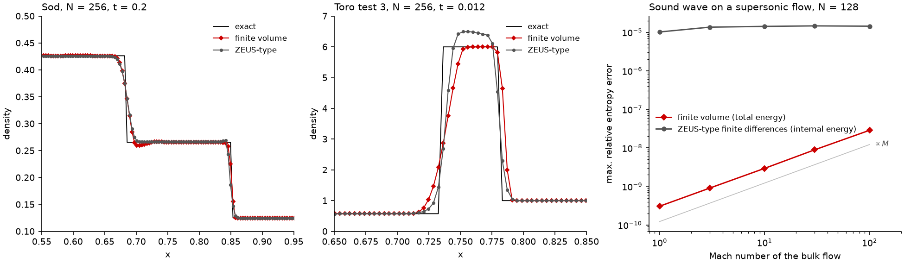

# E03.1: finite-volume Godunov against ZEUS-type finite differences

numpy 2.5.3, Python 3.14.8, macOS-26.7.1-x86_64-i386-64bit-Mach-O. gamma = 1.4. FV: total energy, PLM (MC) on primitives, HLL, SSP-RK2, CFL 0.4. FD: internal energy, staggered velocity, artificial viscosity C2 = 2, van Leer transport, Courant 0.5.

## 1. Sod (t = 0.2)

| Scheme | N | L1 error of density | Plateau pressure error | Mass change | Total-energy change | Steps |
|---|---|---|---|---|---|---|
| FV | 128 | 4.05e-03 | -2.57e-04 | +0.0e+00 | +0.0e+00 | 140 |
| FD | 128 | 5.21e-03 | -2.43e-03 | +2.2e-16 | -1.9e-03 | 148 |
| FV | 256 | 2.19e-03 | -1.56e-04 | +0.0e+00 | +0.0e+00 | 281 |
| FD | 256 | 3.14e-03 | -2.10e-03 | +0.0e+00 | -1.4e-03 | 295 |
| FV | 512 | 1.24e-03 | -6.62e-05 | +0.0e+00 | +0.0e+00 | 563 |
| FD | 512 | 1.84e-03 | -1.88e-03 | +0.0e+00 | -1.1e-03 | 589 |
| FV | 1024 | 6.55e-04 | -3.38e-05 | +0.0e+00 | +0.0e+00 | 1126 |
| FD | 1024 | 1.28e-03 | -1.75e-03 | +0.0e+00 | -9.4e-04 | 1178 |

## 1. Toro test 3 (t = 0.012)

| Scheme | N | L1 error of density | Plateau pressure error | Mass change | Total-energy change | Steps |
|---|---|---|---|---|---|---|
| FV | 128 | 1.08e-01 | -5.24e-03 | +0.0e+00 | +0.0e+00 | 205 |
| FD | 128 | 8.06e-02 | -6.12e-03 | +3.9e-06 | -3.7e-03 | 170 |
| FV | 256 | 6.10e-02 | -2.27e-03 | +2.2e-16 | +0.0e+00 | 410 |
| FD | 256 | 5.16e-02 | -5.69e-03 | +1.7e-08 | -3.4e-03 | 339 |
| FV | 512 | 3.69e-02 | -9.91e-04 | +0.0e+00 | +0.0e+00 | 821 |
| FD | 512 | 3.69e-02 | -4.48e-03 | +8.6e-13 | -3.2e-03 | 676 |
| FV | 1024 | 1.81e-02 | -5.53e-04 | +0.0e+00 | -2.2e-16 | 1642 |
| FD | 1024 | 3.14e-02 | -3.80e-03 | -1.1e-16 | -3.0e-03 | 1348 |

## 2. Sound wave on a bulk flow (N = 128, amplitude 0.001, t = 0.25)

Maximum relative error of the specific entropy p / rho^gamma, which is exactly uniform in the true solution.

| Bulk Mach number | FV (total energy) | FD (internal energy) | Steps FV / FD |
|---|---|---|---|
| 0 | 4.60e-11 | 1.14e-08 | 81 / 65 |
| 1 | 3.05e-10 | 1.02e-05 | 161 / 91 |
| 3 | 9.02e-10 | 1.36e-05 | 321 / 203 |
| 10 | 2.94e-09 | 1.43e-05 | 881 / 644 |
| 30 | 8.90e-09 | 1.47e-05 | 2481 / 1922 |
| 100 | 2.86e-08 | 1.44e-05 | 8081 / 6401 |

