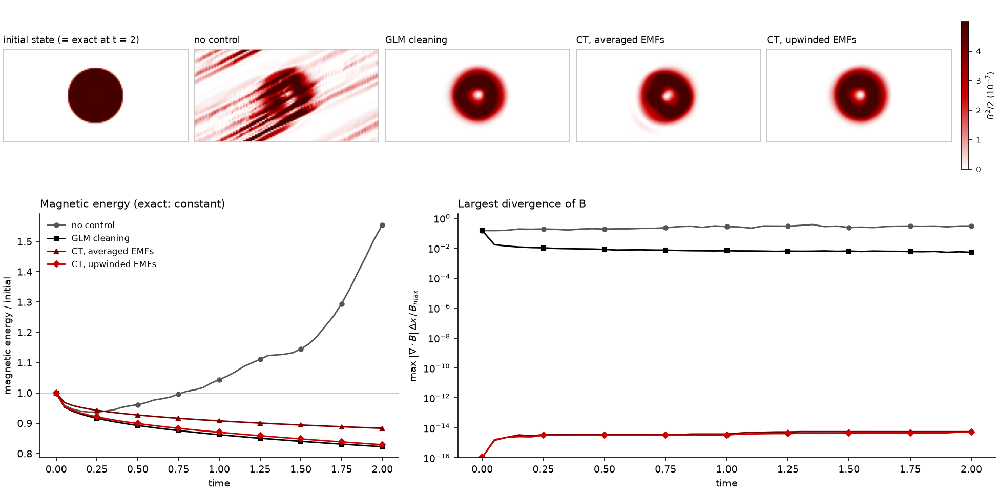

# E03.2: divergence control on the field-loop advection test

numpy 2.5.3, Python 3.14.8, macOS-26.7.1-x86_64-i386-64bit-Mach-O. 128 x 64 cells, t = 2.0, CFL 0.4, gamma = 5/3; PLM (MC) on primitives, HLL, SSP-RK2 for every scheme.

| Divergence treatment | Magnetic energy at t = 2 | Scaled div B at t = 0 | Scaled div B at t = 2 | L1 field error at t = 2 | Steps | Seconds |
|---|---|---|---|---|---|---|
| none | 1.555 | 1.5e-01 | 3.1e-01 | 1.63e-01 | 1080 | 25.0 |
| GLM cleaning | 0.823 | 1.5e-01 | 5.3e-03 | 2.58e-02 | 1080 | 27.4 |
| CT, averaged EMFs | 0.884 | 1.1e-16 | 5.6e-15 | 3.17e-02 | 1080 | 27.7 |
| CT, upwinded EMFs (Gardiner & Stone) | 0.829 | 1.1e-16 | 5.2e-15 | 2.57e-02 | 1080 | 29.4 |

Magnetic energy is relative to its initial value; the exact solution keeps it at 1. The divergence is each scheme's own discrete divergence (face-centred for CT, central differences of the cell-centred field otherwise), scaled by the cell size and the largest initial field strength. The cell-centred schemes start from a non-zero value because their divergence operator differs from the face-centred one the initial field was constructed with.

