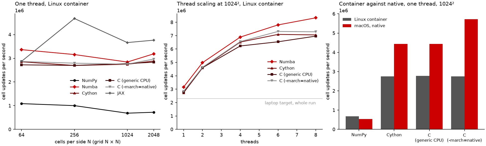
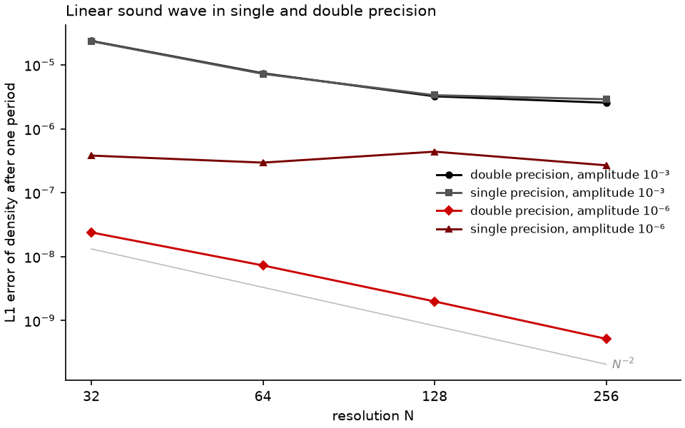

# D04 — Compute backend and kernel model

| | |
|---|---|
| Status | Decided (frozen); partly superseded |
| Decided | 2026-10-10 |
| Supersedes | D01.5 (by D04.5) |
| Superseded by | D04.2 → D09.2 (in part) |

## 1. Introduction

This brief decides how the numerical kernels of mhdpy are written and executed. The kernels are the loops over cells that reconstruct states, solve Riemann problems and update the solution, and they account for nearly all of a simulation's run time. The brief also decides in which precision they compute, how their correctness is verified, and how compiled code is built and shipped.

The choice is constrained from several sides:

- **Performance (architecture.md §1.3).** A thesis-scale run of about 10¹¹ cell updates must finish overnight on the development laptop, which means roughly 2 × 10⁶ cell updates per second for the whole machine. A small server must reach 3 × 10⁷. E02.1 measured about 7 × 10⁵ for a 1D NumPy solver on one core.
- **Installation (§1.4).** Installation must be a single `pip` or `uv` command, whatever the ranking would otherwise imply. E01.1 found that Numba and JAX publish no wheels for macOS on Intel, the development machine, and none at all for Python 3.14 there.
- **Verification (D02).** Kernels must be measurable by coverage (100 % of lines *and* branches, D02.8), testable in isolation, and deterministic, with exact symmetries.
- **Discretisation (D03).** The representative kernels are second-order finite-volume reconstruction, the Riemann solver and the edge EMFs of constrained transport. The production target is a hydrodynamics run.
- **Tooling (D01).** D01.5 chose uv_build provisionally, to be superseded here if compiled code is introduced. ruff does not lint `.pyx` files and pyright cannot see into compiled code.

**What the references do** (syntheses in `References/`):

- **Athena++** writes its kernels in C++ and selects implementations at compile time (link-time polymorphism, S20), for vectorised kernels without virtual-call overhead. Its successor AthenaK **[GK]** moved to Kokkos for GPU portability.
- **Pyro** keeps orchestration in Python and JIT-compiles a few hot kernels (interface states, Riemann solvers, artificial viscosity) with Numba. Its 2014 version used Fortran through f2py.
- **Ulula** is pure, vectorised NumPy. Its paper measures about 4 × 10⁻⁷ s per cell per step in 2D and concludes that the code is limited by NumPy's throughput, not by Python overhead.
- **ZEUS** was Fortran 77.

## 2. Evidence

All three experiments implement the same kernel: one SSP-RK2 step of 2D hydrodynamics with MC-limited reconstruction of the primitive variables and HLL fluxes. That is the representative kernel of D03, written with identical arithmetic in every technology: [`E04.1a-hydro2d-numpy.py`](experiments/E04.1a-hydro2d-numpy.py), [`-numba.py`](experiments/E04.1b-hydro2d-numba.py), [`-cython.pyx`](experiments/E04.1d-hydro2d-cython.pyx), [`-c.c`](experiments/E04.1c-hydro2d-c.c), [`-jax.py`](experiments/E04.1e-hydro2d-jax.py) and [`E04.3a-hydro2d-purepython.py`](experiments/E04.3a-hydro2d-purepython.py). One cell update means one full time step of one cell.

### E04.1 — The same kernel in five technologies

**Method.** [`experiments/E04.1h-run.py`](experiments/E04.1h-run.py) runs [`E04.1f-benchmark.py`](experiments/E04.1f-benchmark.py) in two environments:

- **A Linux container** (Docker, on the development machine's CPU, 8 virtual CPUs; GCC 12 with OpenMP) for all technologies, since Numba and JAX cannot be installed on macOS on Intel.
- **Natively on macOS** (Apple Clang 21, without OpenMP) for those available there.

The C kernel is built twice: for a generic x86-64 CPU, as a distributed wheel is, and for the exact CPU (`-march=native`), as Numba compiles. The runs measure correctness against NumPy after five steps, single-thread throughput for grids of 64² to 2048² cells, thread scaling at 1024², and start-up cost. [`E04.1i-diagnostics.sh`](experiments/E04.1i-diagnostics.sh) checks two observations (below). Full output: [`results/E04.1h-benchmark.md`](experiments/results/E04.1h-benchmark.md), [`results/E04.1i-diagnostics.txt`](experiments/results/E04.1i-diagnostics.txt).

**Results.**

| Technology | Bit-for-bit equal to NumPy | 1 thread, Linux, 1024² | 1 thread, macOS, 1024² | 8 threads, Linux, 1024² | First call / build |
|---|---|---|---|---|---|
| NumPy | (reference) | 6.8 × 10⁵ | 5.3 × 10⁵ | — | 0.2 s |
| Numba | yes | 2.8 × 10⁶ | not installable | 8.3 × 10⁶ | 10.6 s compilation on first call |
| Cython (`.pyx`) | yes | 2.8 × 10⁶ | 4.4 × 10⁶ | 7.1 × 10⁶ | 9 s build |
| C, generic CPU | yes | 2.8 × 10⁶ | 4.4 × 10⁶ | 7.0 × 10⁶ | 0.3 s build |
| C, `-march=native` | no (4.5 × 10⁻¹⁶) | 2.8 × 10⁶ | 5.7 × 10⁶ | 7.3 × 10⁶ | 0.3 s build |
| JAX | no (4.5 × 10⁻¹⁶) | 3.7 × 10⁶ | not installable | (XLA's own) | 1.1 s compilation on first call |

- **All compiled technologies are equally fast, given the same loop structure:** 4× NumPy in the container and 8× natively. A first version of the C kernel ran 30 % slower than Cython purely because of how its loops were written. Code structure matters as much as the language.
- **JAX was the fastest on one thread.** The diagnostics confirm this is not hidden multithreading: it is XLA fusing the whole step into a few loops.
- **Throughput is flat from 64² to 2048² cells for every compiled technology.** Python's call overhead is negligible already for blocks of 64² cells.
- **Threads give 2.5–3× on 8 virtual CPUs.** With the laptop target for the whole run at 2.3 × 10⁶, every compiled technology exceeds it for pure hydrodynamics even on one thread. NumPy falls short by a factor of 3 to 4 before cooling and conduction are added.
- **Bit-for-bit agreement with NumPy holds for Numba, Cython and generic C.** It is lost wherever the compiler fuses multiply-adds (FMA): `-march=native`, and JAX. For results that must agree across environments, that is the D02.3 lesson again.
- **The compiled kernels run about 1.5× faster natively on macOS than in the container,** while NumPy is slightly faster in the container. The diagnostics rule out the compiler as the cause: GCC and Clang give the same speed in the container, and `-fno-math-errno` changes nothing. The cause therefore lies in the container itself or in the newer compiler on macOS. The *ranking* of the technologies is the same in both environments.

### E04.2 — Installation footprint and coverage

**Method.** [`experiments/E04.2b-run.py`](experiments/E04.2b-run.py) sums the PyPI wheel sizes each runtime adds. It then runs [`E04.2a-coverage.py`](experiments/E04.2a-coverage.py) in the container, which tries to measure the coverage of each kernel with coverage.py. Full output: [`results/E04.2b-footprint-and-coverage.md`](experiments/results/E04.2b-footprint-and-coverage.md).

**Results.**

| Technology | Extra download (Linux / macOS ARM) | Coverage of the kernel with coverage.py |
|---|---|---|
| NumPy (needed by every option) | 16.7 / 5.4 MB | normal |
| Numba | 63.5 / 43.3 MB | lines and branches (97.7 %, 24 of 26), with `NUMBA_DISABLE_JIT=1` |
| JAX | 93.7 / 68.3 MB | not attempted |
| Cython (`.pyx`) | none: compiled into mhdpy's own wheel | **lines only** (96 %): a special tracing build (15× slower) and two non-default settings |
| C | none: compiled into mhdpy's wheel | **not possible** with coverage.py |

The Cython result took two non-obvious settings to obtain, both found while setting up the experiment. On Python 3.14, coverage.py's default engine does not support Cython's plugin, and Cython 3.1 and later report their line events through a mechanism that the classic engine does not receive. Even then, branch coverage of `.pyx` code is not available. Branch coverage is part of D02.8's requirement.

### E04.3 — One source file, compiled for speed and run uncompiled for verification

**Question.** Cython also offers a *pure Python mode*: the kernel is an ordinary `.py` file, and its C types are given as annotations from the `cython` module. Can one such file serve both as the fast compiled kernel and as uncompiled Python for coverage and checks?

**Method.** [`experiments/E04.3c-run.py`](experiments/E04.3c-run.py) runs [`E04.3b-purepython.py`](experiments/E04.3b-purepython.py) in the container. It tests [`E04.3a-hydro2d-purepython.py`](experiments/E04.3a-hydro2d-purepython.py), the `.pyx` kernel rewritten in pure Python mode, compiled and uncompiled. Full output: [`results/E04.3b-purepython.json`](experiments/results/E04.3b-purepython.json).

**Results.**

| | Pure Python mode |
|---|---|
| Compiled: bit-for-bit equal to NumPy | yes |
| Compiled: 1 thread, 1024² (container) | 3.6 × 10⁶, against 2.7 × 10⁶ for the `.pyx` kernel |
| Compiled: 4 threads | 7.6 × 10⁶ |
| Uncompiled: coverage of lines / branches | 97 % / 24 of 26, the same as Numba with the JIT off |
| Uncompiled: time for one step at 16² | 0.6 s |
| ruff (D01.7 rules) | no findings |
| pyright (D01.8) | 24 errors: Cython's annotations (`cython.double[:, :, ::1]`) are not valid Python typing |

The compiled pure-mode kernel is even faster than the `.pyx` one. It uses Python's built-in `min`, `max` and `abs` (required because Python's `math` module, which the uncompiled file falls back to, has no `fmin`). Cython compiles those to inline comparisons, whereas `fmin` and `fmax` are calls into the C maths library. The two uncovered branches are the purely supersonic cases of the Riemann solver, which the subsonic test state never reaches. Finding exactly such gaps is what D02.8's coverage requirement is for.

**What the three experiments mean together.**

- Any compiled technology meets the performance target with room to spare, and NumPy alone does not.
- Numba and JAX are excluded on the development machine and for every user of an Intel Mac. JAX also adds about 90 MB of dependencies and needs static array shapes **[GK]**, which conflicts with mesh refinement.
- Cython's pure Python mode combines the speed and portability of compiled code with what Numba offers for verification: full line and branch coverage of the uncompiled source. Its cost is that pyright cannot type-check the kernel files.

### E04.4 — What single precision would change

*Added after the decision on precision (D04.4), for future reference; it does not affect that decision.*

**Method.** [`experiments/E04.4a-precision.py`](experiments/E04.4a-precision.py) (natively, one thread) measures two things:

- **Speed:** one step of the E04.1 kernel at 1024² cells in both precisions, for NumPy and for the compiled pure-Python-mode kernel. The single-precision kernel is generated from the same source by declaring `cython.float` instead of `cython.double`. Its arrays are single precision, but C partly evaluates its expressions in double precision because of literals such as 0.5, so its speed-up is a lower bound.
- **Accuracy:** E02.1's linear sound wave after one period, here on the 2D kernel with NumPy, which keeps single-precision arrays in single precision throughout. It is run for N = 32 … 256 and amplitudes 10⁻⁶ and 10⁻³, together with the change in total mass.

[`E04.4b-figure.py`](experiments/E04.4b-figure.py) draws the figure. Full output: [`results/E04.4a-precision.md`](experiments/results/E04.4a-precision.md).

**Results.**

| | Double precision | Single precision |
|---|---|---|
| NumPy, cell updates per second | 5.4 × 10⁵ | 9.4 × 10⁵ (1.75×) |
| Compiled kernel, cell updates per second | 4.1 × 10⁶ | 5.8 × 10⁶ (1.41×) |
| L1 error, amplitude 10⁻⁶, N = 32 → 256 | 2.4 × 10⁻⁸ → 5.2 × 10⁻¹⁰ (order 2) | 3.8 × 10⁻⁷ → 2.7 × 10⁻⁷ (no convergence) |
| L1 error, amplitude 10⁻³, N = 32 → 256 | 2.4 × 10⁻⁵ → 2.6 × 10⁻⁶ | 2.4 × 10⁻⁵ → 2.9 × 10⁻⁶ |
| Change of total mass (N = 256) | 0 to 2 × 10⁻¹⁶ | 7 × 10⁻⁸ to 2 × 10⁻⁶ |

**What this means.**

- **Single precision is 1.4–1.75× faster.**
- **It stops converging altogether once the errors approach its round-off level.** For the small wave its error stays around 3 × 10⁻⁷ at every resolution, up to 500× worse than double precision.
- **Mass is conserved only to 10⁻⁷–10⁻⁶,** where double precision conserves it to round-off.
- **For the large wave both precisions level off at about 3 × 10⁻⁶.** That limit is physical, not numerical. At this amplitude the wave steepens noticeably over one period, so the initial state is no longer the exact solution to that level.
- **Single precision is adequate only where the quantities of interest are far above 10⁻⁷ relative.** It cannot meet the correctness criteria of convergence and conservation to round-off. This confirms D04.4.

### E04.5 — The cost of the Python orchestration

*Added after the first review, in answer to the question how much the Python orchestration of D04.2 costs.*

**Method.** [`experiments/E04.5-orchestration.py`](experiments/E04.5-orchestration.py) (natively, one thread) splits one SSP-RK2 step into the two calls of the compiled pure-Python-mode kernel (E04.3) and everything around them: copying the state, filling ghost cells and combining the stages. It does so for blocks of 16² to 1024² cells and three ways of writing that orchestration, which give bit-for-bit identical results:

- plain NumPy expressions, as in E04.1;
- the same operations in place, with preallocated arrays and `out=` arguments;
- the two stage combinations as small compiled kernels.

It also times a bare call into compiled code. Full output: [`results/E04.5-orchestration.md`](experiments/results/E04.5-orchestration.md).

**Results.** Share of each step spent outside the compiled kernel calls, with the resulting cell updates per second:

| Block | Plain NumPy | NumPy in place | Compiled stage combination |
|---|---|---|---|
| 32² | 43 % (5.5 × 10⁶) | 41 % (5.7 × 10⁶) | 19 % (7.8 × 10⁶) |
| 64² | 29 % (7.2 × 10⁶) | 28 % (7.2 × 10⁶) | 19 % (8.1 × 10⁶) |
| 128² | 34 % (6.0 × 10⁶) | 26 % (6.8 × 10⁶) | 11 % (8.1 × 10⁶) |
| 1024² | 41 % (4.7 × 10⁶) | 25 % (5.9 × 10⁶) | 12 % (7.0 × 10⁶) |

**What this means.**

- **The Python interpreter costs nothing worth mentioning:** a call into compiled code takes 0.16 µs.
- **What does cost is NumPy operations that sweep over the whole block.** Because the compiled kernel is fast, a few such sweeps with temporary arrays take a third of a step.
- **Compiling the stage combinations removes most of that** (to 11–19 %) and raises throughput by about 50 % at large blocks. The remainder is mostly the ghost filling, which only touches the edges.
- **Blocks of 64² to 128² cells are the fastest per cell,** about 8 × 10⁶ cell updates per second on one core, presumably because their working set fits in the CPU cache.

## 3. Decisions

### D04.1 — Kernel technology

In which technology are the numerical kernels written?

**Options**

- **A. NumPy only (as Ulula).** No build step, simplest code. 4–8× slower than compiled code (E04.1), and short of the laptop target by a factor of 3 to 4 before any extra physics.
- **B. Numba (as Pyro).** Loops written in plain Python, compiled on first use. Fast (E04.1), and fully measurable by coverage with the JIT switched off (E04.2). But it cannot be installed on macOS on Intel (E01.1), including the development machine on Python 3.14. It adds 64 MB of dependencies and costs a compilation of about 10 s at every start-up, unless cached.
- **C. Cython, in pure Python mode.** Kernels are `.py` files with Cython type annotations, compiled to C when the package is built. They are as fast as hand-written C, and faster than Cython's own `.pyx` here (E04.1, E04.3). They need no runtime dependency, so they install wherever wheels are built, including macOS on Intel. The same files run uncompiled for coverage of lines and branches (E04.3). Costs: per-platform wheels must be built (D04.5); pyright cannot check the kernel files (E04.3); OpenMP needs care on macOS (D05).
- **D. Cython with `.pyx` files.** As C for speed and portability. But coverage measures lines only, through a special build, and ruff cannot lint the files (E04.2).
- **E. C or C++ extensions** (with nanobind or pybind11), the approach of Athena++. As fast as Cython, given the same loop structure (E04.1), and **[GK]** the route to GPUs through Kokkos or CUDA. But the kernels move into a second language, invisible to coverage.py, ruff and pyright, and every kernel would need a separately maintained Python twin for D02.
- **F. JAX.** The fastest single-thread result in E04.1, thanks to whole-step fusion, and **[GK]** the same code runs on GPUs. But it is not installable on macOS on Intel, adds about 90 MB, is not bit-for-bit reproducible against the reference (FMA), and **[GK]** compiles for fixed array shapes, so it recompiles whenever mesh refinement changes the number of blocks.
- **G. Rust** (PyO3) or **Pythran**: not measured. **[GK]** Rust would bring a second language with the same verification gap as E. Pythran compiles NumPy-style code, but its development has slowed.

**Recommendation.** C, Cython in pure Python mode. It is the only option that satisfies every constraint at once:

- **correctness:** bit-for-bit agreement with the reference, and coverage of lines *and* branches from the same source file (E04.3);
- **performance:** 5–8× NumPy, at the level of hand-written C;
- **the installation exception:** wheels for every target platform, including the development machine, and no runtime dependency.

Numba would be the closest alternative and is simpler to write. It is ruled out only by the installation exception and the development machine, but that exception explicitly outranks everything else. The one real cost of C is that pyright cannot check kernel files. D01.8 already relaxes typing inside kernels, and the kernels' *interfaces* (the plain Python functions that call them) remain fully typed. GPU acceleration, an aspiration rather than a target (architecture.md §1.2), is not served by Cython. It would require a separate GPU backend for the same kernel interface (D04.2), which C neither helps nor prevents.

**Decision.** *(2026-10-10)* **C, Cython in pure Python mode.** With Numba not installable on the development machine, Cython is the only realistic option. Writing the kernels in C instead is not desired: it would mean working in a language without prior experience, without a gain in speed (E04.1).

### D04.2 — Kernel structure

> Superseded in part by D09.2 (2026-10-12): kernels are called for a range of blocks and loop over them in compiled code, instead of once per block. Kernels as functions over arrays, with Python orchestrating, still stand.

How are kernels shaped and called?

**Options**

- **A. Kernels as functions over arrays with explicit loops,** taking every input and output array as an argument (scratch arrays included), and allocating and holding nothing themselves. Each call processes a whole block. Python orchestrates: it allocates, fills ghost zones, combines integrator stages and calls the kernels.
- **B. Vectorised array expressions throughout** (NumPy style), compiled where possible. Natural in NumPy and JAX, but not how fast Cython or C is written, and each expression allocates temporaries.
- **C. Larger compiled units:** the whole time step, or the whole integration loop, in compiled code. Least overhead, but the orchestration, which D02 wants testable and D03.1 wants interchangeable, disappears into compiled code.

**Recommendation.** A. E04.1 shows that the per-call overhead of Python is already negligible at 64² cells per call, so whole-block kernels lose nothing to C. A keeps every kernel testable in isolation (D02), keeps the method-of-lines structure and the interchangeable spatial operator of D03.1 in Python, where they are readable, and gives a clean interface behind which a different backend (for example for GPUs) could later be placed. Loops in the kernels should follow the memory layout, with the innermost loop along the contiguous index. As a pointer for D07, blocks of 64² cells or larger keep call overhead negligible. This serves **performance**, **readability** and **extensibility**.

**Decision.** *(2026-10-10)* **A, kernels as functions over arrays with explicit loops, one call per block, with Python orchestrating.** Option C has its appeal, but it would make testing harder, so it is not chosen. Asked whether the Python orchestration costs much, experiment E04.5 was added, with a refinement as its outcome:

- The **Python interpreter itself costs almost nothing:** a call into compiled code takes 0.16 µs.
- The **whole-array NumPy operations of the orchestration do cost noticeably.** Copying the state, filling ghost cells and combining the Runge–Kutta stages take 30–40 % of a step when written as plain NumPy expressions.
- **Compiling the stage combinations as small kernels** brings this down to about 12 %, with bit-for-bit identical results.

A is therefore applied as follows. Python decides *what* happens and in which order: stages, kernel calls, ghost exchange. Every operation that touches all cells of a block, including the combination of integrator stages, is a compiled kernel. Small operations, such as filling ghost zones, may remain NumPy. E04.5 also shows the highest throughput for blocks of 64² to 128² cells, a pointer for D07.

### D04.3 — Verifying the kernels

How are compiled kernels covered and checked, given D02.8's requirement of 100 % line and branch coverage?

**Options**

- **A. Tracing builds of the compiled kernels.** For Cython `.pyx`, lines only, 15× slower, and dependent on two non-default settings (E04.2). For C, impossible with coverage.py.
- **B. One source, run both ways.** The pure-Python-mode kernel file runs *uncompiled* in tests that measure coverage, on small grids (0.6 s per step at 16², E04.3), and *compiled* in all other tests. A test asserts that compiled and uncompiled results are bit-for-bit identical on the same platform, so the coverage measured on the uncompiled file applies to the compiled code. A switch (for example an environment variable) selects the uncompiled kernels.
- **C. A separately maintained Python reference for every kernel,** with equivalence tests. It works for any technology, but doubles the kernel code and the risk that the two drift apart.

**Recommendation.** B. It gives D02.8's full line and branch coverage from the very source that is compiled. The bit-for-bit equivalence test makes "covered" mean the same for both forms, and E04.3 shows that equivalence is attainable. It avoids C's duplication. A NumPy implementation of a kernel can still be added as an *independent* reference where a second derivation of the result is valuable, but that becomes a choice per kernel, not an obligation. This serves **correctness**.

**Decision.** *(2026-10-10)* **B, one source, run both ways**, following the recommendation. Option C would have a didactic appeal: every kernel mirrored in plain Python, for testing and as an explanation in itself. But writing every kernel twice is not worth the workload. The uncompiled pure-Python-mode source already reads as Python and partly serves that purpose.

### D04.4 — Floating-point precision

In which precision do the kernels compute?

**Options**

- **A. Double precision (float64) throughout.** Round-off at about 10⁻¹⁶ relative. Conservation to round-off and convergence tests down to errors of 10⁻¹¹ (E02.1) are possible.
- **B. Configurable precision** (float32 or float64), with float64 as the default. **[GK]** Single precision halves memory and bandwidth, which roughly doubles the speed of bandwidth-bound kernels and matters most on GPUs. In Cython it requires fused types or a second compilation of every kernel.
- **C. Single precision (float32) by default.** Round-off at about 10⁻⁷ relative. Convergence studies stall at that level, and conservation is only to 10⁻⁷.

**Recommendation.** A, double precision throughout. The correctness criterion asks for conservation to round-off and convergence at the formal order, and E02.1's linear-wave errors reach 10⁻¹¹, far below what single precision can represent. Single precision mainly pays off on GPUs, which are an aspiration. Should that become relevant, a later brief can supersede this one; keeping the dtype in one place in the code makes that cheap. This serves **correctness**.

**Decision.** *(2026-10-10)* **A, double precision throughout**, in line with the correctness goal. For future reference, experiment E04.4 records what single precision would have changed in speed and accuracy. Its outcome does not alter this decision.

### D04.5 — Building and shipping compiled code

How is compiled code built and distributed? This supersedes D01.5 (uv_build) if compiled code is chosen in D04.1.

**Options**

- **A. meson-python.** **[GK]** The build backend of NumPy and SciPy, with first-class support for Cython (including pure Python mode) and for OpenMP detection. Wheels are built in CI with cibuildwheel for every supported platform and Python version, plus an sdist.
- **B. scikit-build-core.** **[GK]** CMake-based; natural for C++ projects, more configuration for Cython.
- **C. setuptools with Cython's `cythonize`.** The classic route (Pyro, Ulula use setuptools), widely documented, but configured in Python code rather than declaratively, and slower to build.

Under every option, wheels are built for macOS (Intel and Apple Silicon) and Linux (x86-64 and ARM) on Python 3.13 and 3.14. Without a matching wheel, pip and uv build from the sdist, which needs a C compiler. **[GK]** cibuildwheel runs the test suite against every wheel it builds, so the D01.4 wheel test extends to all platforms.

**Recommendation.** A, meson-python with cibuildwheel. It is what the scientific Python stack mhdpy depends on uses for exactly this purpose: Cython kernels in a Python package, wheels for every platform. It is also declarative, consistent with keeping configuration in `pyproject.toml` (D01). The work is mainly one-time: the CI workflow for wheels. This serves the **installation exception** (wheels everywhere) and **correctness** (every wheel tested).

**Decision.** *(2026-10-10)* **A, meson-python with cibuildwheel**, consistent with NumPy and SciPy. This supersedes D01.5 (uv_build).

### D04.6 — Compiler optimisation and CPU target

For which CPU are the kernels compiled?

**Options**

- **A. A generic CPU per platform** (baseline x86-64, ARMv8) with `-O3`, as every distributed wheel must be. Bit-for-bit equal to the reference (E04.1).
- **B. The exact CPU of the build machine** (`-march=native`), possible only for local builds from source. 28 % faster natively on macOS in E04.1 (no gain in the container), but results differ in the last bits from the reference because of fused multiply-adds, and the build cannot run on older CPUs.
- **C. A, with B available as an opt-in for local builds** (for example a build option when installing from source on a cluster).

**Recommendation.** C. Distributed wheels must be generic, and that keeps the bit-for-bit agreement with the reference on which D04.3 relies. Users who build on their own hardware can choose the extra speed, knowing that bit-for-bit comparisons with the uncompiled kernels then no longer hold and must use a tolerance. This serves **correctness** by default and **performance** on request.

**Decision.** *(2026-10-10)* **C: generic wheels for everyone, a processor-specific build as an option.** The distributed wheels run on every supported computer, so mhdpy works for everyone with a single command. Users who are more involved and want the extra performance can build mhdpy themselves, optimised for their own processor. The installation documentation offers this as an explicit, optional route, along the following lines (the exact build option is settled when the build system is set up):

> **Installing mhdpy.** `pip install mhdpy` (or `uv add mhdpy`) installs ready-built packages that run on every supported computer and produce results identical to the reference builds.
>
> **Optional: a build tuned to your own processor.** If you run long simulations on one particular machine, you can compile mhdpy specifically for that machine's processor, which can make the computational kernels noticeably faster (around 30 % in experiment E04.1). This requires a C compiler and takes longer to install. Because the compiler may then combine arithmetic operations differently, results can differ from the standard builds in the last digits, and the build runs only on processors of the same kind. For example: `pip install mhdpy --no-binary mhdpy -C setup-args=-Dcpu=native`.

## 4. Consequences for higher layers

**For every layer**

- Numerical kernels are `.py` files in Cython's pure Python mode inside the package. They are compiled when the package is built, and run uncompiled when a switch requests it.
- Every operation that touches all cells of a block is a compiled kernel: fluxes and updates, conversions between variables, and the combination of integrator stages. Python decides the order of operations and handles small tasks such as filling ghost zones (D04.2, E04.5).
- Kernels take all their arrays as arguments, scratch arrays included, and allocate nothing. Their loops run with the innermost loop along the contiguous index.
- Kernel files are checked by ruff, but pyright cannot interpret Cython's annotations (E04.3). They are therefore excluded from pyright, while the Python functions that call them stay fully typed (D01.8).
- All computation is in double precision. The floating-point type is defined in one place, so that a later decision could change it cheaply (D04.4, E04.4).

**For the verification of D02**

- Coverage is measured with the kernels uncompiled, on small inputs. Uncompiled, one step at 16² cells takes about 0.6 s, so kernel tests use tiny grids or individual states.
- An equivalence test asserts that compiled and uncompiled kernels give bit-for-bit identical results on the same platform. That makes the uncompiled coverage valid for the compiled code (D04.3).
- Test states must reach every branch of a kernel. E04.3 found the purely supersonic branches of the Riemann solver uncovered by a subsonic test state.
- A locally built, processor-specific version (D04.6) agrees with the uncompiled kernels only within a tolerance. The equivalence tests must recognise such builds.

**For brief D05 (parallelism)**

- Threads can work at two levels. Inside a kernel, with OpenMP (`prange`), OpenMP must be bundled with the macOS wheels, since Apple's compiler has none. Across blocks, kernels release the GIL (`nogil`), so Python threads, or free-threaded Python, can run several blocks at once.
- E04.1 measured 2.5–3× on 8 virtual CPUs inside a kernel. D05 chooses the level, and must keep results deterministic (D02): reductions in a fixed order.

**For brief D06 (data model)**

- The kernels of E04 assume C-contiguous double-precision arrays with the variable index first (`[var, i, j]`), passed as typed memoryviews. D06 fixes the layout, and the kernels follow it.

**For brief D07 (mesh)**

- Blocks of 64² to 128² cells in 2D were the fastest per cell (E04.5), and below about 32² cells the share of orchestration grows quickly. This is a starting point for the choice of block size.

**For brief D11 (time integration)**

- The combination of integrator stages is a compiled kernel (E04.5). Low-storage Runge–Kutta schemes, which combine registers with weights, map naturally onto one such kernel per stage.

**For the project setup (D01, superseding D01.5)**

- The build moves to meson-python: Cython becomes a build requirement, and a `meson.build` describes the extension modules.
- A CI workflow builds wheels with cibuildwheel for macOS (Intel and Apple Silicon) and Linux (x86-64 and ARM) on Python 3.13 and 3.14, tests each wheel, and publishes an sdist.
- CI runs the tests both with compiled and with uncompiled kernels. The coverage job uses the uncompiled ones.
- A build option compiles for the processor of the build machine (D04.6). The installation documentation describes it as an optional route, in the wording of D04.6, as soon as the build exists.

**For the aspiration of GPU acceleration**

- Cython does not run on GPUs. A GPU version would be a separate backend implementing the same kernel interface (D04.2): arrays in, arrays out, no state. Keeping that interface clean is what keeps the option open.
