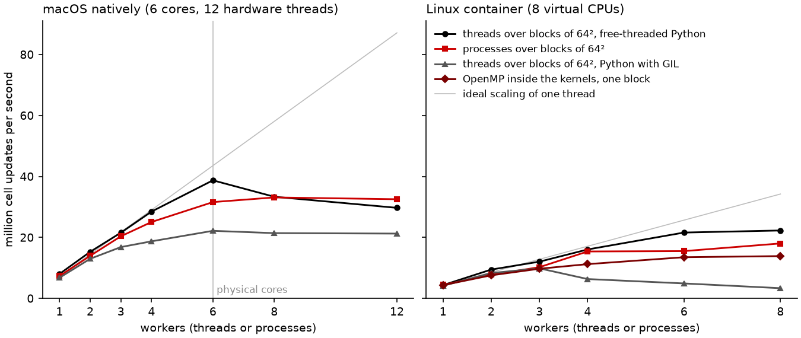

# E05.2: shared-memory parallelism on the 2048 × 512 grid

Cell updates per second (one update = one full SSP-RK2 step of one cell), and in brackets the speed-up over the single block on one thread of the same run. ✓ = bit-for-bit identical to the single-block serial reference after four steps, ✗ = not.

## macOS natively, Python 3.14 (with GIL)

macOS-26.7.1-x86_64-i386-64bit-Mach-O, 12 logical CPUs; Python 3.14.8, NumPy 2.5.3; GIL enabled after importing the kernels: True; OpenMP: False.

| Configuration | 1 worker | 2 workers | 3 workers | 4 workers | 6 workers | 8 workers | 12 workers |
|---|---|---|---|---|---|---|---|
| single block, one thread | 7.26e+06 (1.0×) ✓ |  |  |  |  |  |  |
| blocks of 32², Python threads | 6.29e+06 (0.9×) ✓ | 1.06e+07 (1.5×) ✓ | 1.26e+07 (1.7×) ✓ | 1.15e+07 (1.6×) ✓ | 1.19e+07 (1.6×) ✓ | 1.24e+07 (1.7×) ✓ | 1.18e+07 (1.6×) ✓ |
| blocks of 32², processes | 6.61e+06 (0.9×) ✓ | 1.36e+07 (1.9×) ✓ | 1.71e+07 (2.3×) ✓ | 2.44e+07 (3.4×) ✓ | 2.94e+07 (4.1×) ✓ | 3.13e+07 (4.3×) ✓ | 3.37e+07 (4.6×) ✓ |
| blocks of 64², Python threads | 6.82e+06 (0.9×) ✓ | 1.30e+07 (1.8×) ✓ | 1.69e+07 (2.3×) ✓ | 1.87e+07 (2.6×) ✓ | 2.22e+07 (3.1×) ✓ | 2.14e+07 (3.0×) ✓ | 2.13e+07 (2.9×) ✓ |
| blocks of 64², processes | 7.36e+06 (1.0×) ✓ | 1.40e+07 (1.9×) ✓ | 2.04e+07 (2.8×) ✓ | 2.51e+07 (3.5×) ✓ | 3.16e+07 (4.4×) ✓ | 3.31e+07 (4.6×) ✓ | 3.25e+07 (4.5×) ✓ |
| blocks of 128², Python threads | 7.58e+06 (1.0×) ✓ | 1.37e+07 (1.9×) ✓ | 1.76e+07 (2.4×) ✓ | 2.13e+07 (2.9×) ✓ | 2.39e+07 (3.3×) ✓ | 2.34e+07 (3.2×) ✓ | 2.00e+07 (2.8×) ✓ |
| blocks of 128², processes | 8.11e+06 (1.1×) ✓ | 1.58e+07 (2.2×) ✓ | 1.99e+07 (2.7×) ✓ | 2.35e+07 (3.2×) ✓ | 2.66e+07 (3.7×) ✓ | 2.56e+07 (3.5×) ✓ | 2.26e+07 (3.1×) ✓ |

## macOS natively, Python 3.14t (free-threaded)

macOS-26.7.1-x86_64-i386-64bit-Mach-O, 12 logical CPUs; Python 3.14.8, NumPy 2.5.3; GIL enabled after importing the kernels: False; OpenMP: False.

| Configuration | 1 worker | 2 workers | 3 workers | 4 workers | 6 workers | 8 workers | 12 workers |
|---|---|---|---|---|---|---|---|
| single block, one thread | 7.21e+06 (1.0×) ✓ |  |  |  |  |  |  |
| blocks of 32², Python threads | 6.41e+06 (0.9×) ✓ | 1.20e+07 (1.7×) ✓ | 1.94e+07 (2.7×) ✓ | 2.60e+07 (3.6×) ✓ | 3.00e+07 (4.2×) ✓ | 3.49e+07 (4.8×) ✓ | 3.60e+07 (5.0×) ✓ |
| blocks of 32², processes | 6.80e+06 (0.9×) ✓ | 1.26e+07 (1.7×) ✓ | 1.95e+07 (2.7×) ✓ | 2.45e+07 (3.4×) ✓ | 3.35e+07 (4.6×) ✓ | 3.44e+07 (4.8×) ✓ | 3.60e+07 (5.0×) ✓ |
| blocks of 64², Python threads | 8.06e+06 (1.1×) ✓ | 1.53e+07 (2.1×) ✓ | 2.16e+07 (3.0×) ✓ | 2.85e+07 (4.0×) ✓ | 3.87e+07 (5.4×) ✓ | 3.34e+07 (4.6×) ✓ | 2.97e+07 (4.1×) ✓ |
| blocks of 64², processes | 7.53e+06 (1.0×) ✓ | 1.25e+07 (1.7×) ✓ | 2.09e+07 (2.9×) ✓ | 2.37e+07 (3.3×) ✓ | 3.05e+07 (4.2×) ✓ | 3.36e+07 (4.7×) ✓ | 3.00e+07 (4.2×) ✓ |
| blocks of 128², Python threads | 7.59e+06 (1.1×) ✓ | 1.46e+07 (2.0×) ✓ | 1.84e+07 (2.6×) ✓ | 2.08e+07 (2.9×) ✓ | 2.38e+07 (3.3×) ✓ | 2.09e+07 (2.9×) ✓ | 1.94e+07 (2.7×) ✓ |
| blocks of 128², processes | 7.69e+06 (1.1×) ✓ | 1.40e+07 (1.9×) ✓ | 1.89e+07 (2.6×) ✓ | 2.25e+07 (3.1×) ✓ | 2.46e+07 (3.4×) ✓ | 2.35e+07 (3.3×) ✓ | 2.05e+07 (2.8×) ✓ |

## Linux container, Python 3.14 (with GIL)

Linux-7.0.14-linuxkit-x86_64-with-glibc2.36, 8 logical CPUs; Python 3.14.2, NumPy 2.5.3; GIL enabled after importing the kernels: True; OpenMP: True.

| Configuration | 1 worker | 2 workers | 3 workers | 4 workers | 6 workers | 8 workers |
|---|---|---|---|---|---|---|
| single block, one thread | 4.28e+06 (1.0×) ✓ |  |  |  |  |  |
| single block, loop-level OpenMP | 4.37e+06 (1.0×) ✓ | 7.59e+06 (1.8×) ✓ | 9.75e+06 (2.3×) ✓ | 1.13e+07 (2.6×) ✓ | 1.35e+07 (3.2×) ✓ | 1.39e+07 (3.2×) ✓ |
| blocks of 32², Python threads | 4.14e+06 (1.0×) ✓ | 7.49e+06 (1.7×) ✓ | 8.48e+06 (2.0×) ✓ | 4.16e+06 (1.0×) ✓ | 1.58e+06 (0.4×) ✓ | 1.44e+06 (0.3×) ✓ |
| blocks of 32², processes | 4.28e+06 (1.0×) ✓ | 8.23e+06 (1.9×) ✓ | 1.22e+07 (2.8×) ✓ | 1.58e+07 (3.7×) ✓ | 1.84e+07 (4.3×) ✓ | 1.93e+07 (4.5×) ✓ |
| blocks of 64², Python threads | 4.16e+06 (1.0×) ✓ | 8.34e+06 (1.9×) ✓ | 9.87e+06 (2.3×) ✓ | 6.37e+06 (1.5×) ✓ | 4.93e+06 (1.2×) ✓ | 3.37e+06 (0.8×) ✓ |
| blocks of 64², processes | 4.46e+06 (1.0×) ✓ | 7.77e+06 (1.8×) ✓ | 1.03e+07 (2.4×) ✓ | 1.54e+07 (3.6×) ✓ | 1.55e+07 (3.6×) ✓ | 1.80e+07 (4.2×) ✓ |
| blocks of 128², Python threads | 4.14e+06 (1.0×) ✓ | 7.04e+06 (1.6×) ✓ | 1.05e+07 (2.5×) ✓ | 1.05e+07 (2.5×) ✓ | 1.05e+07 (2.4×) ✓ | 9.90e+06 (2.3×) ✓ |
| blocks of 128², processes | 4.77e+06 (1.1×) ✓ | 8.66e+06 (2.0×) ✓ | 1.09e+07 (2.5×) ✓ | 1.33e+07 (3.1×) ✓ | 1.54e+07 (3.6×) ✓ | 1.62e+07 (3.8×) ✓ |

## Linux container, Python 3.14t (free-threaded)

Linux-7.0.14-linuxkit-x86_64-with-glibc2.36, 8 logical CPUs; Python 3.14.3, NumPy 2.5.3; GIL enabled after importing the kernels: False; OpenMP: True.

| Configuration | 1 worker | 2 workers | 3 workers | 4 workers | 6 workers | 8 workers |
|---|---|---|---|---|---|---|
| single block, one thread | 4.39e+06 (1.0×) ✓ |  |  |  |  |  |
| single block, loop-level OpenMP | 4.36e+06 (1.0×) ✓ | 7.78e+06 (1.8×) ✓ | 9.42e+06 (2.1×) ✓ | 1.12e+07 (2.5×) ✓ | 1.31e+07 (3.0×) ✓ | 1.32e+07 (3.0×) ✓ |
| blocks of 32², Python threads | 3.78e+06 (0.9×) ✓ | 7.72e+06 (1.8×) ✓ | 1.28e+07 (2.9×) ✓ | 1.69e+07 (3.8×) ✓ | 2.05e+07 (4.7×) ✓ | 2.30e+07 (5.2×) ✓ |
| blocks of 32², processes | 3.96e+06 (0.9×) ✓ | 7.57e+06 (1.7×) ✓ | 1.17e+07 (2.7×) ✓ | 1.51e+07 (3.4×) ✓ | 2.03e+07 (4.6×) ✓ | 1.97e+07 (4.5×) ✓ |
| blocks of 64², Python threads | 4.37e+06 (1.0×) ✓ | 9.48e+06 (2.2×) ✓ | 1.21e+07 (2.7×) ✓ | 1.61e+07 (3.7×) ✓ | 2.16e+07 (4.9×) ✓ | 2.23e+07 (5.1×) ✓ |
| blocks of 64², processes | 4.42e+06 (1.0×) ✓ | 9.29e+06 (2.1×) ✓ | 1.13e+07 (2.6×) ✓ | 1.55e+07 (3.5×) ✓ | 1.83e+07 (4.2×) ✓ | 2.03e+07 (4.6×) ✓ |
| blocks of 128², Python threads | 4.50e+06 (1.0×) ✓ | 7.99e+06 (1.8×) ✓ | 1.14e+07 (2.6×) ✓ | 1.41e+07 (3.2×) ✓ | 1.57e+07 (3.6×) ✓ | 1.65e+07 (3.8×) ✓ |
| blocks of 128², processes | 4.76e+06 (1.1×) ✓ | 8.44e+06 (1.9×) ✓ | 1.15e+07 (2.6×) ✓ | 1.34e+07 (3.1×) ✓ | 1.63e+07 (3.7×) ✓ | 1.59e+07 (3.6×) ✓ |

