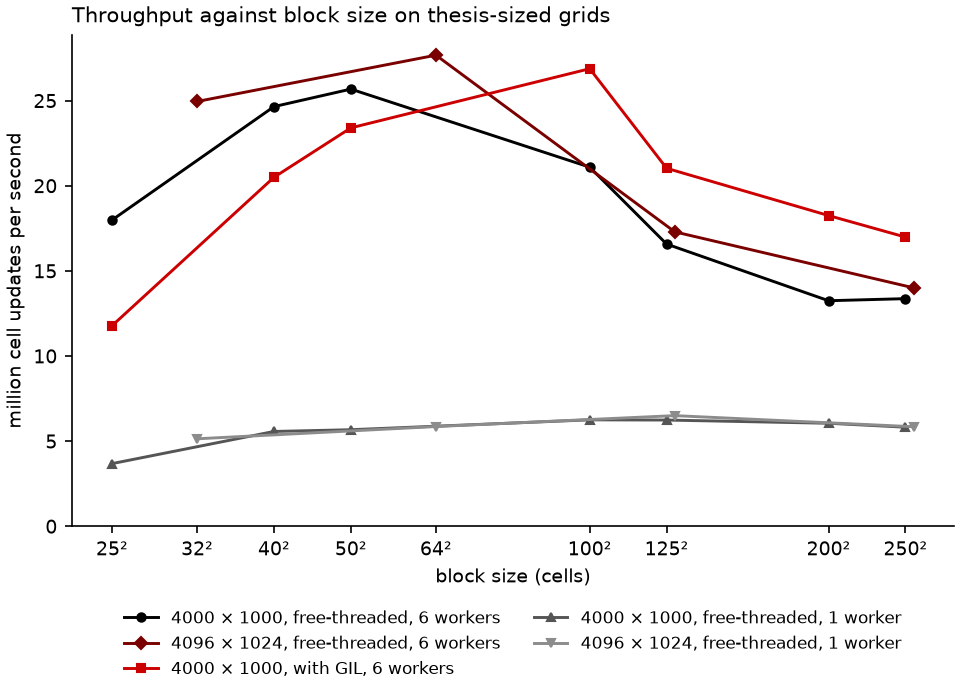

# D07 — Mesh and geometry

| | |
|---|---|
| Status | Decided (frozen) |
| Decided | 2026-10-11 |
| Supersedes | — |
| Superseded by | — |

## 1. Introduction

This brief decides how the computational domain is divided and described. It covers:

- the components that hold the domain and their names;
- whether the domain is one grid or a set of blocks, and of what shape;
- how blocks are organised and find their neighbours;
- the size and shape of blocks and the width of their ghost zones;
- how coordinate systems and nonuniform spacing are represented;
- what is prepared now for mesh refinement, which is implemented later.

Communication between blocks, physical boundary conditions, and the restriction and prolongation of data are left to D08.

The earlier briefs already fix much of the frame:

- **The layering (D06 §1).** Three components share the work:
  - a *grid* describes the geometry of one block and holds no data;
  - the *mesh* arranges the grids into the block structure and knows how they border each other;
  - the *state* describes all variables and stores them for all blocks of a process, giving each grid a view.

  D06 left the precise terms to this brief.
- **Data model (D06).** Arrays are `[block, var, k, j, i]` per process, with x contiguous and always three-dimensional. Directions with extent 1 have no ghost cells. One array per process for each centring and role means every block of a process must have *the same shape*. Grids must also supply their geometry as arrays for the kernels, packed per process for the same reason as the state.
- **Parallelism (D05).** The block is the unit of data ownership and of parallel work, and every worker needs several blocks. Sums are combined in a canonical block order that must not depend on the worker or process. Blocks of 32²–64² scaled best in parallel, and 64²–128² ran fastest on one core (E04.5, E05.2).
- **Discretisation (D03).** The ghost width is a parameter, so that higher-order schemes can widen it.
- **Scope (architecture.md §1.2).** The thesis problem is a uniform 2D grid of 4000 × 1000 cells. Mesh refinement, curvilinear coordinates (cylindrical, spherical polar) and nonuniform spacing are part of the eventual scope and of the roadmap: uniform grid first, then mesh refinement, then curvilinear coordinates.

The thesis grid adds a practical constraint. 4000 × 1000 cannot be divided into blocks of 64² cells. The square blocks that tile it exactly have sides that divide 1000 (8, 10, 20, 25, 40, 50, 100, 125, 200, 250, 500, 1000).

**What the references do** (syntheses in `References/`):

- **Athena** (C) organised static mesh refinement as nested *Domains*, one per refined region and level, each divided into *Grids*, one per process. These are patches of arbitrary size. Its 1D, 2D and 3D integrators were separate.
- **Athena++** replaced that with *MeshBlocks* of identical size; S20 gives the poor scaling of patch-based refinement as a reason for the rewrite.
  - Even a uniform grid is a set of MeshBlocks.
  - The blocks are organised in a binary tree, quadtree or octree, built deep enough to cover the root blocks, so some nodes stay empty.
  - Each block has a *logical location* (level and integer position).
  - Neighbours are found through the tree.
  - Blocks are assigned to processes along the tree's Z-order (Morton order).
  - The mesh must be divisible by the block size, and with refinement the block size must be even **[GK]**.
  - Neighbouring blocks may differ by at most one level, and all levels share one time step.
  - Geometry sits in a `Coordinates` object per block, selected at compile time (Cartesian, cylindrical, spherical polar, general-relativistic variants). It holds face and volume-centre positions, widths, face areas, edge lengths, volumes and the geometric source terms.
  - Nonuniform spacing comes from a geometric ratio or a user function.
  - Limiters are adapted to nonuniform and curvilinear grids.
  - Geometric source terms are written so that angular momentum is conserved to machine precision.
- **Pyro** keeps geometry in `Grid2d` (geometry only, deliberately ignorant of boundary conditions and data). Its subclasses `Cartesian2d` and `SphericalPolar` supply face areas and volumes, and solvers write the update as flux × area ÷ volume, so the same code serves both geometries. It has a single grid, with no blocks and no refinement.
- **Ulula** has one uniform Cartesian grid without a mesh abstraction; its synthesis lists that among the things that would need restructuring for curvilinear coordinates or refinement.
- **ZEUS** used a covariant formulation with precomputed scale and volume factors, so that the same equations serve Cartesian, cylindrical and spherical grids.

## 2. Evidence

### E07.1 — Block sizes on the thesis grid

**Method.** [`experiments/E07.1b-block-size.py`](experiments/E07.1b-block-size.py) runs full SSP-RK2 steps of the D06 kernel ([`E07.1a-kernels.py`](experiments/E07.1a-kernels.py): five variables, layout `[block, var, k, j, i]`, direction-specific) on two periodic grids:

- the thesis grid of 4000 × 1000 cells, divided into blocks that tile it exactly: squares of 25² to 250², and two rectangles elongated along x (100 × 50, 200 × 50);
- for comparison, a 4096 × 1024 grid with power-of-two blocks (32² to 256²).

The parallel model is that of D05: Python threads over fixed, contiguous ranges of blocks, ghost cells filled from the neighbouring blocks with NumPy copies, and a barrier after each stage. Every configuration is checked bit for bit against a single-block serial reference. [`E07.1c-run.py`](experiments/E07.1c-run.py) runs the benchmark natively with the free-threaded interpreter (1 and 6 workers) and the standard one (6 workers). [`E07.1d-figure.py`](experiments/E07.1d-figure.py) draws the figure. Full output: [`results/E07.1c-block-size.md`](experiments/results/E07.1c-block-size.md).

**Results.** Million cell updates per second on the thesis grid (✓ throughout: all 41 configurations were bit-for-bit identical to the reference):

| Block | Blocks | Cells stored per interior cell | Free-threaded, 1 worker | Free-threaded, 6 workers | With GIL, 6 workers |
|---|---|---|---|---|---|
| 4000 × 1000 (one block) | 1 | 1.01 | 5.8 | — | — |
| 25² | 6400 | 1.35 | 3.7 | 18.0 | 11.8 |
| 40² | 2500 | 1.21 | 5.6 | 24.7 | 20.5 |
| 50² | 1600 | 1.17 | 5.7 | 25.7 | 23.4 |
| 100 × 50 | 800 | 1.12 | 6.2 | **27.4** | **28.6** |
| 100² | 400 | 1.08 | 6.3 | 21.1 | 26.9 |
| 125² | 256 | 1.07 | 6.3 | 16.6 | 21.0 |
| 200² | 100 | 1.04 | 6.1 | 13.3 | 18.3 |
| 250² | 64 | 1.03 | 5.8 | 13.4 | 17.0 |

On the 4096 × 1024 grid, 64² blocks gave 27.7 (6 workers) and 5.9 (1 worker), and 32² gave 25.0 and 5.1. These are in line with the neighbouring thesis-grid sizes.

- **Block sizes need not be powers of two.** Sizes that tile the thesis grid (40², 50², 100 × 50) perform like the powers of two around them.
- **Parallel runs want blocks of about 2500 to 5000 cells in 2D;** one core wants about 10⁴. On 6 workers, 50² and 100 × 50 blocks were twice as fast as 200² blocks. On one worker, 100²–125² were best, but only 10 % ahead of 50². The parallel optimum is the one that matters, and it costs little on one core.
- **Below about 40², overhead takes over.** At 25², ghost cells add 35 % to the cells stored, and per-block overhead grows; the single-worker speed falls by 40 %.
- **Rectangular blocks elongated along the contiguous direction were the best on the thesis grid** (100 × 50). That gives long inner loops with fewer cells per block.
- **Blocking also pays on one core:** 100² blocks were 9 % faster than one block of the whole grid, presumably through cache reuse.
- **With the standard interpreter, the best block size shifts to larger blocks** (corrected 2026-10-12, see the note below). It was faster than the free-threaded one from 100² upward (26.9 against 21.1 at 100²) and slower below (11.8 against 18.0 at 25²); its best was 100 × 50 (28.6). Larger blocks mean less Python per cell, and with the GIL that Python is serialised. Run-to-run variation on the laptop is about ±15 % (the free-threaded 50² run gave 25.7 here and 29.8 in E08.1), so differences of that size between separate runs are not significant.

> **Correction (2026-10-12).** The column "With GIL" originally showed a run that, unintentionally, also used the free-threaded interpreter. uv reused the cached environment of the free-threaded run for the request "3.14". That run had led to the statement that the standard interpreter was as fast as the free-threaded one. The driver now requests "3.14+gil", the run was repeated, and the column, the bullet above and the figure show the corrected results. The decisions of this brief do not depend on that column: the default block size of D07.3 is derived from the free-threaded results, which the free-threaded focus of D05.3 makes the primary target. For the standard interpreter, 50² blocks are about 18 % slower than its best size; D09 can take this into account when it chooses defaults per interpreter.

### E07.2 — The cost of general geometry

**Method.** In curvilinear or nonuniform coordinates, face areas and cell volumes vary from cell to cell. [`experiments/E07.2b-geometry.py`](experiments/E07.2b-geometry.py) (natively, one thread) times the flux divergence, the step where they enter, in three forms ([`E07.2a-divergence.py`](experiments/E07.2a-divergence.py)):

- **uniform Cartesian**, with one cell width;
- **separable 1D factors**, where every area and volume is a product of one factor per direction, stored as 1D arrays. That covers every orthogonal coordinate system, including cylindrical and spherical polar with nonuniform spacing **[GK]**;
- **full arrays** of areas and volumes for every face and cell.

Each is compared with one full evaluation of the time derivative. With Cartesian values, all three reproduced the kernel's own result bit for bit. Geometry also enters the reconstruction (slopes on nonuniform grids) and adds source terms in curvilinear coordinates; those belong to D10 and are not measured. Full output: [`results/E07.2b-geometry.md`](experiments/results/E07.2b-geometry.md).

**Results.** Divergence step as a share of one full kernel evaluation, and geometry memory relative to the block's conserved state:

| Block | Uniform Cartesian | Separable 1D factors | Full arrays |
|---|---|---|---|
| 2D, 64² | 10.6 % | 18.4 % (memory 2 %) | 13.0 % (memory 89 %) |
| 2D, 512² | 13.6 % | 17.8 % (0.3 %) | 19.7 % (99 %) |
| 3D, 32³ | 9.9 % | 16.2 % (0.2 %) | 15.4 % (58 %) |
| 3D, 64³ | 14.1 % | 18.3 % (0.0 %) | 21.2 % (68 %) |

- **General geometry adds a few per cent to the kernel:** 4–8 % with 1D factors, 2–7 % with full arrays.
- **Full arrays cost nearly as much memory as the state itself; separable factors cost almost nothing.** For orthogonal coordinates, the separable form loses nothing.
- **A specialised uniform-Cartesian kernel would save those 4–8 %.** Since kernels are to be produced per direction anyway (D06.3, D10), a Cartesian specialisation could be produced the same way.

**What the two experiments mean together.**

- Blocks should be about 50² cells in 2D for parallel runs. Their size should be free to follow the grid, rectangular included, not restricted to powers of two.
- Geometry can be general at small cost, as separable 1D arrays per block, which also pack per process (D06) without noticeable memory.

## 3. Decisions

### D07.1 — Components and their names

Which components describe the domain, and what is each responsible for?

**Options**

- **A. The layering of D06 §1, with each term defined precisely:**
  - **Grid:** the geometry of one block, holding no field data. It covers the block's extent in cells, active directions and ghost width, and the coordinates of cells, faces, edges and nodes, with widths, areas and volumes (D07.6). It is a lightweight object, one per block.
  - **Block:** a logical location in the mesh (D07.4), its grid, and its index in the state's arrays.
  - **Mesh:** the set of blocks, the physical domain and its root division into blocks, neighbour relations, the canonical order of blocks, the assignment of blocks to workers and processes, and (later) refinement.
  - **State:** the registry of variables and their storage for all blocks of a process (D06).
  - **Coordinate system:** Cartesian, cylindrical or spherical polar, with uniform or nonuniform spacing. It computes the geometry that the grids hold.
- **B. Athena++'s arrangement:** a MeshBlock object that owns both geometry (`Coordinates`) and data (physics objects with their arrays). Familiar from Athena++, but it ties data to blocks, the opposite of the per-process storage of D06.4.
- **C. One global grid for the whole domain, with blocks as index ranges into it.** Simplest for a uniform grid, but it does not extend to refinement, where blocks at different levels have different cell sizes, and every block would share one set of coordinate arrays.

**Recommendation.** A, the layering already agreed for D06, with the definitions above. It keeps geometry, structure and data apart, in line with Pyro's grid/data split and Athena++'s separation of mesh and physics, while fitting the per-process storage of D06. This serves **readability** and **extensibility**.

**Decision.** *(2026-10-11)* **A, the layering of D06 §1 with the definitions above.** It follows the structure set out when D06 was drafted. The names (grid, block, mesh, state, coordinate system) and the hierarchy between them are hereby fixed.

### D07.2 — Blocks of identical shape

Is the domain divided into blocks of the same shape, or into patches of varying size?

**Options**

- **A. Every block has the same number of cells in each direction,** as Athena++'s MeshBlocks. Even a uniform grid is a set of blocks, and a single block is the special case of a small problem. Refinement replaces a block by 2^d children of the same shape. The same shape is what lets all blocks of a process share one array (D06.4) and one compiled kernel call shape.
- **B. Patches of varying size,** as Athena's SMR domains and grids, or **[GK]** Berger–Colella-style patch-based refinement. Fits refined regions tightly, but every patch has its own shape, so no shared array, no batching, and S20 reports poor scaling.
- **C. A single grid now, blocks later.** Simplest to start, but D05 and D06 are built on blocks, and retrofitting them is the redesign the scope rules out.

**Recommendation.** A. It is the only option compatible with the decisions of D05 and D06 (block-level threads, per-process arrays), and it is the approach Athena++ moved to after experience with B. This serves **performance** and **extensibility**.

**Decision.** *(2026-10-11)* **A, blocks of identical shape.** Patches of varying size bring additional overhead that could put the performance targets at risk.

### D07.3 — Block size and shape

How is the size of the blocks chosen?

**Options**

- **A. Chosen by the user, constrained only by tiling:** any number of cells per direction, independently per direction, as long as it divides the number of cells of the root grid in that direction (and is even when refinement is enabled).
- **B. As A, with a default chosen automatically when the user gives none:** per direction, the divisor of the grid size closest to a target, about 64 cells in 2D and 32 in 3D. The default must also leave enough blocks for several per worker. For the thesis grid this gives 50 × 50 blocks.
- **C. Fixed power-of-two sizes** (for example 64²), with the grid required to be a multiple. Simple, but the thesis grid could not be run as specified.

**Recommendation.** B. E07.1 shows that block sizes need not be powers of two, that rectangular blocks are fine (100 × 50 was the best on the thesis grid), and that parallel throughput varies by a factor of two with block size. A good default matters for users who do not want to tune; an explicit choice remains possible for those who do. The targets come from E07.1 (2D) and Athena++'s recommendation of 32³–64³ (3D), and are to be revisited with the full physics. This serves **performance** and **ease of use**.

**Decision.** *(2026-10-11)* **B, free choice constrained only by tiling, with an automatic default**, following the recommendation.

### D07.4 — Organising the blocks

How are blocks identified, and how are neighbours and the canonical order found?

**Options**

- **A. An explicit tree,** as Athena++: binary tree, quadtree or octree nodes with parent and child links, built deep enough to cover the root blocks (some nodes stay empty). Neighbours are found by walking the tree; the Z-order (Morton order) comes from traversing it.
- **B. Logical locations in a lookup table** **[GK]** (a "linear" tree, as in libraries such as p4est). Every block is identified by its level and integer position, `(level, lx, ly, lz)`. A dictionary maps locations to blocks. Parents, children and neighbours follow from arithmetic on the location: halve, double, offset by one, and wrap at periodic boundaries. The canonical order is the Morton order of the locations, computed rather than traversed. The root grid may have any number of blocks per direction (the thesis grid at 50² is 80 × 20 root blocks).
- **C. A flat list with a neighbour table,** sufficient for a uniform grid only.

**Recommendation.** B. It provides everything the tree of A provides (levels, parents, children, neighbours, Morton order) with a dictionary and integer arithmetic, which is simpler and more readable in Python than linked nodes. It does not need empty nodes for root grids that are not powers of two. The Morton order is the canonical block order D05.5 asks for: independent of workers and processes, with good locality when contiguous ranges of it are assigned to workers. C would have to be replaced at the first refinement. This serves **readability** and **extensibility**.

**Decision.** *(2026-10-11)* **B, logical locations in a lookup table, with the Morton order as canonical order**, following the recommendation, as the most logical way forward.

### D07.5 — Ghost width

How many ghost cells does a block have?

**Options**

- **A. Fixed at two,** enough for the second-order scheme.
- **B. Set once at set-up,** as the largest stencil requirement of the selected operators (reconstruction, diffusion, refinement), equal in every active direction and zero in inactive ones. With refinement enabled it is even **[GK]**, as Athena++ requires.
- **C. Per variable or per direction.** Saves memory where some variables need fewer ghost cells, but every array of one centring would no longer have one shape (D06.4).

**Recommendation.** B. D03 requires the ghost width to be a parameter for higher-order schemes, and deriving it from the selected operators keeps users from having to know it. One width for all keeps one shape per array. This serves **correctness** (no stencil can read past the ghost zone) and **extensibility**.

**Decision.** *(2026-10-11)* **B, set once at set-up.** The operators whose requirements determine it include the physical boundary conditions, some of which need more or fewer ghost cells than others. The width is the largest requirement of all selected operators; an operator that needs fewer ghost cells uses only as many as it needs.

### D07.6 — Coordinate systems and the representation of geometry

How is geometry represented for the kernels?

**Options**

- **A. Separable 1D arrays per direction, for every coordinate system.** Each grid holds, per direction:
  - face and cell-centre positions and widths;
  - the 1D factors of face areas, edge lengths and volumes;
  - volume centroids for reconstruction on nonuniform grids.

  These are packed per process (`[block, n + 1]`) like the state. One representation serves Cartesian, cylindrical and spherical-polar coordinates, uniform and nonuniform (geometric ratio or a user function, as Athena++). +4–8 % on the kernel against uniform Cartesian, almost no memory (E07.2).
- **B. Full arrays of areas and volumes per face and cell,** as Pyro's area and volume arrays. Equally general, the same speed, but nearly doubles memory (E07.2), and nothing is gained for orthogonal coordinates.
- **C. Uniform Cartesian only for now** (a cell width per direction), with geometry arrays added when curvilinear coordinates arrive. Fastest for now, but every kernel would have to be revisited later.

**Recommendation.** A. One representation for all orthogonal coordinate systems, so that curvilinear coordinates and nonuniform spacing need no change to the data model or to kernel signatures. It costs a few per cent of speed and no meaningful memory. Whether kernels additionally get a uniform-Cartesian specialisation, worth 4–8 % (E07.2), is decided with the way kernels are produced (D10). The coordinate system is chosen per simulation; the geometric source terms and the adaptations of reconstruction belong to D10. Coordinate systems with non-separable metrics (general relativity) are outside the current scope. This serves **extensibility** at a small cost in **performance**.

**Decision.** *(2026-10-11)* **A, separable 1D arrays per direction**, following the recommendation, with a provision for geometry that is not separable. Asked whether this would get in the way of nonuniform grids or general coordinate systems later, the answer differs per case:
- **Nonuniform grids are fully covered.** Spacing that varies along each direction, by a geometric ratio or any user function, is exactly what the per-direction arrays hold. The same holds for Athena++, whose nonuniform spacing is also per direction.
- **Not covered: grids whose spacing along one direction depends on the position in another,** such as mapped or distorted meshes. Neither are coordinate systems whose metric is not a product of per-direction factors, such as the Kerr–Schild metric of general relativity. Their geometry depends on two or three indices at once.
- **For those, a second representation would be needed:** geometry as full arrays per block, packed per process. E07.2 measured its cost: about the same speed, and roughly the memory of the state again.

  Adding it changes neither the data model nor the mesh. The coordinate system decides which representation its grids hold, and the kernels for such a system would be different kernels in any case: general relativity needs its own Riemann solvers, primitive recovery and source terms. To keep that door open:
  - only the coordinate system and the kernels see the representation of geometry;
  - the rest of the code asks grids for geometry through the coordinate-system interface, never by assuming separability;
  - the coordinate system is chosen once per simulation.

  Keeping this door open is an explicit requirement, not merely a possibility. The design must stay able to accommodate distorted (mapped, non-orthogonal) meshes and the full range of coordinate systems that general-relativistic physics can need. For such geometry, faces are no longer aligned with the coordinate directions, and the geometry includes face normals and a metric that varies in every direction. The coordinate-system interface is therefore designed for the general case: geometry quantities per face, edge and cell, of which the separable form is one compact representation. It is not designed around separability with the general case added as an exception.

### D07.7 — Provisions for mesh refinement

What is prepared now for mesh refinement, which is implemented later?

**Options**

- **A. Design for refinement now, implement it later:**
  - logical locations carry a level (D07.4);
  - block sizes are even when refinement is enabled, and so is the ghost width;
  - neighbouring blocks differ by at most one level;
  - the registry carries each variable's restriction and prolongation operators (D06.6);
  - the state's arrays can be resized when blocks appear or disappear;
  - the canonical order and the assignment of blocks to workers follow from the Morton order, so they adapt when blocks change.

  Static refinement (fixed regions) comes first, adaptive refinement after it. Whether all levels share one time step (Athena++) is left to D11.
- **B. Uniform grids only,** with refinement as a later redesign.

**Recommendation.** A. Mesh refinement is on the roadmap directly after the uniform-grid milestone, and every provision above is cheap now and expensive to retrofit. Each is also either already implied by D05 and D06 or part of D07.4. This serves **extensibility**.

**Decision.** *(2026-10-11)* **A, provisions now, implementation later**, following the recommendation. Mesh refinement will be implemented: it can reduce the cost of a run considerably by concentrating resolution where it is needed.

## 4. Consequences for higher layers

**For every layer**

- The terms are fixed (D07.1):
  - **grid:** the geometry of one block;
  - **block:** a logical location, a grid and an index in the state's arrays;
  - **mesh:** the blocks, the domain, neighbours, canonical order and assignment;
  - **state:** the variables and their storage;
  - **coordinate system:** computes the geometry.

  Documentation and code use them consistently.
- All blocks have the same number of cells per direction. The block size divides the root grid per direction, may differ between directions, and need not be a power of two. Without an explicit choice it defaults to the divisor nearest about 64 cells (2D) or 32 cells (3D) (D07.2, D07.3).
- Blocks are identified by `(level, lx, ly, lz)`. The canonical block order is the Morton order of these locations. It is used for reductions (D05.5), for the order of blocks in the state's arrays and for the assignment of contiguous ranges to workers and, later, processes (D07.4).
- The ghost width is set once at set-up as the largest requirement of all selected operators, including physical boundary conditions, and is equal in every active direction (D07.5).
- Geometry reaches kernels as separable 1D arrays per direction, packed per process. Only coordinate systems and kernels depend on that representation. The coordinate-system interface is designed for the general case: distorted, non-orthogonal meshes and general-relativistic metrics, with per-face, per-edge and per-cell geometry and face normals. The separable form is one compact representation of it, and a full-array representation can be added later without touching the rest (D07.6).

**For brief D08 (boundaries and communication)**

- Neighbours follow from the logical locations, including across periodic boundaries; physical boundaries are where a neighbour location falls outside the root grid.
- Boundary conditions declare how many ghost cells they need (D07.5).
- With refinement, neighbours may differ by one level. D08 designs the exchange with coarser and finer neighbours, flux and EMF correction, and restriction and prolongation through the registered operators (D06.6, D07.7).

**For brief D09 (execution model)**

- Blocks are assigned to workers as contiguous ranges of the Morton order, with several blocks per worker. With 50² blocks, the thesis grid has 1600 blocks.

**For brief D10 (numerical building blocks)**

- Kernels take geometry as separable 1D factors. Reconstruction on nonuniform grids (slopes relative to volume centroids, as Athena++) and the geometric source terms of curvilinear coordinates are designed there.
- D10 decides whether kernels also get a uniform-Cartesian specialisation, worth 4–8 % of the kernel (E07.2), produced the same way as the per-direction code (D06.3).

**For brief D11 (time integration)**

- With refinement, D11 decides whether all levels share one time step, as in Athena++, or levels are subcycled.

**For brief D14 (I/O) and restarts**

- Outputs and restarts record logical locations and the root grid, so that the block structure can be reconstructed, also after refinement has changed it.

**For the roadmap**

- Mesh refinement will be implemented after the uniform-grid milestone, static refinement first, then adaptive (D07.7). The provisions listed under D07.7 are part of the uniform-grid implementation from the start.
